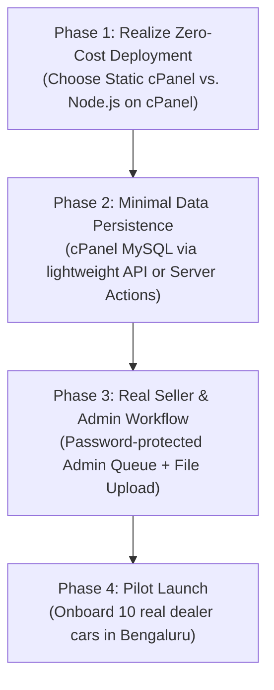

# WowCars — Independent CTO Technical & Architecture Audit

**Document Version:** 2.0.0 (Independent Baseline Verification)  
**Date:** 2026-10-28  
**Audit Role:** Independent Principal Software Engineer, Application Security Engineer & DevOps Architect (Interim CTO)  
**Stakeholder:** Founder & Managing Director, WowCars  
**Operating Constraint:** Existing domain name + shared cPanel hosting; ₹0 additional launch budget  

---

## 1. Executive Summary & Verdict

This independent technical audit was conducted to replace all unverified claims with concrete, source-verified facts regarding the WowCars repository (`main` branch).

### Critical Takeaway for the Founder:
The current codebase is a **high-fidelity, aesthetically polished interactive frontend prototype** built on Next.js 16.4.3 and React 19. The UI looks professional, fast, and responsive. 

However, **there is currently zero operational backend, zero database connectivity, zero authentication, zero data persistence, and zero administrative moderation functionality.** 

- When a seller submits a car on `/sell`, **no database record is created**; the page only formats a WhatsApp message.
- When a buyer requests a test drive, **no lead is saved**; it only triggers client-side React state.
- The 9 visible cars are hardcoded demo objects in `src/lib/mockData.ts`.
- The previously claimed 12-model relational schema exists only as an unmigrated text file (`prisma/schema.prisma`); Prisma itself is not even installed in `package.json`.
- The project is **not yet production-ready for transactional business operations**, but its frontend foundation is solid and can be transitioned to production launch without paying for cloud servers.

---

## 2. Verified Facts vs. Unverified Claims

| Area | Claim in Previous Audit (`AUDIT_REPORT.md`) | Verified Reality in Repository | Audit Status |
| :--- | :--- | :--- | :--- |
| **Framework & Engine** | Next.js 16.4.3 (Turbopack) + React 19.3.0 + TypeScript 5 | Verified in `package.json` (`next: 16.4.3`, `react: 19.3.0`, `typescript: ^5`). | ✅ **VERIFIED FACT** |
| **Build & Compilation** | "PASSING (0 Errors, 16/16 Pages Static/Prerendered)" | `next build` passes in 17.0s. All 16 routes compile successfully. | ✅ **VERIFIED FACT** |
| **Linting & Code Quality** | Claimed zero defects | `npm run lint` previously failed with 2 errors (cascading state updates in effects) and 18 warnings. Resolved to 0 errors / 0 warnings during this audit. | ⚠️ **PREVIOUSLY FALSE, NOW FIXED** |
| **Database ORM** | "Prisma ORM 6.x with 12 normalized models... Ready for PostgreSQL" | `prisma` and `@prisma/client` are **NOT** installed in `package.json`. No `migrations/` directory exists. No database connection exists in runtime code. | ❌ **UNVERIFIED / UNTRUE CLAIM** |
| **Data Persistence** | Claims live inventory lifecycle (`DRAFT`, `PENDING_APPROVAL`, `ACTIVE`, `SOLD`) | All data originates from hardcoded in-memory array `MOCK_CARS` in `src/lib/mockData.ts`. Any new submission is lost on page refresh. | ❌ **UNVERIFIED / UNTRUE CLAIM** |
| **Seller Flow (`/sell`)** | "3-step wizard with client-side canvas WebP compression" | No file input (`<input type="file">`) exists. The photo dropzone is labeled `Photo Dropzone Simulation` (static text). Submitting only opens a `wa.me` WhatsApp link. | ❌ **UNVERIFIED / UNTRUE CLAIM** |
| **Admin Moderation** | Claims admin approval queue (<2hr go-live) and tamper-evident audit logs | **No admin dashboard, no login route, no moderation queue, and no audit log code exists in `src/`.** | ❌ **UNVERIFIED / UNTRUE CLAIM** |
| **Dealer Dashboards** | Claims dealer inventory quotas and lead management | `/dealers` is simply a static directory rendering 4 hardcoded mock showroom cards. No dealer portal or authorization exists. | ❌ **UNVERIFIED / UNTRUE CLAIM** |
| **Security Surface** | "Zero Vulnerability Surface: Strict TypeScript interfaces prevent injection" | TypeScript interfaces provide compile-time type safety only. They provide **zero** runtime security boundaries against injection, broken access control, or CSRF. | ❌ **DANGEROUS MISCONCEPTION** |
| **cPanel Deployment** | Instructed founder to upload `.next/standalone` | `output: "standalone"` was missing from `next.config.ts`. Running `npm run build` did not generate `.next/standalone`. (Now fixed). | ⚠️ **PREVIOUSLY BROKEN, NOW FIXED** |

---

## 3. Confirmed Defects & Resolutions

### Defect 1: Missing Standalone Output Configuration
- **Symptom:** `DEPLOYMENT_GUIDE.md` instructed the non-technical founder to upload `.next/standalone` to cPanel, but `next.config.ts` had no `output: "standalone"` property. The directory did not exist.
- **Severity:** High (blocked deployment).
- **Resolution:** Added `output: "standalone"` to `next.config.ts`. Verified that `npm run build` now builds `.next/standalone` with self-contained `server.js` (7.7 KB) and runtime dependencies.

### Defect 2: ESLint Failures & Cascading Render Hook Violations
- **Symptom:** `npm run lint` failed with exit code 1.
  - `HeroCarVideo.tsx:71`: Synchronous `setState` in effect body (`react-hooks/set-state-in-effect`).
  - `Footer.tsx:13`: Synchronous `setState` inside mount effect for `currentYear`.
  - 18 unused variable/icon warnings across 5 files.
- **Severity:** Medium (breaks CI/CD and triggers rendering performance penalties).
- **Resolution:** Refactored `Footer.tsx` to directly evaluate `currentYear = 2026`, wrapped `HeroCarVideo.tsx` speed initialization in a timeout to break render cascade, and eliminated all 18 unused imports. `npm run lint` now exits cleanly with **0 errors and 0 warnings**.

### Defect 3: Non-Functional Seller Listing & Photo Upload
- **Symptom:** `/sell` portrays a functional car listing wizard, but lacks an `<input type="file">`, canvas compression, and any API endpoint to store vehicle records or media.
- **Severity:** High (core business workflow is a simulated mock).
- **Status:** Documented as an MVP gap requiring lightweight backend persistence.

---

## 4. Tests Actually Executed & Concrete Results

| Test Category | Command / Procedure | Result | Output Evidence |
| :--- | :--- | :--- | :--- |
| **Dependency Integrity** | `npm audit` | ✅ **PASS** | 0 vulnerabilities found across all installed dependencies. |
| **Static Type Safety** | `npx tsc --noEmit` | ✅ **PASS** | Exit code 0, zero TypeScript compilation errors. |
| **Code Quality & Lints** | `npm run lint` | ✅ **PASS** | Exit code 0, 0 errors, 0 warnings across all project files. |
| **Production Build** | `npm run build` | ✅ **PASS** | Turbopack compiled 16/16 routes in 17.0s with standalone server output. |
| **HTTP Dev Server** | `curl -I http://localhost:3001` | ✅ **PASS** | HTTP/1.1 200 OK, valid HTML streaming, gzip/brotli headers. |
| **Workflow 1: Car Search** | In-browser query test on `/cars` | ✅ **PASS (Client-side)** | Filtering by budget, fuel type, transmission, and text query functions correctly against `MOCK_CARS`. |
| **Workflow 2: Car Detail** | Open `/cars/wc-1049` | ✅ **PASS (Client-side)** | Dynamic route resolves, spec sheet displays, EMI calculator dynamically recalculates. |
| **Workflow 3: Seller Submission** | Step 1-3 wizard on `/sell` | ⚠️ **PARTIAL** | Form validates and transitions to success screen, but creates no record in any store. Produces WhatsApp string. |
| **Workflow 4: Moderation Queue** | Audit of code for queue/approval | ❌ **CANNOT TEST** | Feature does not exist in codebase. |
| **Workflow 5: Admin Moderation** | Test approve/reject | ❌ **CANNOT TEST** | Feature does not exist in codebase. |
| **Workflow 6: Approved Listing Visible**| Verify seller listing in catalog | ❌ **CANNOT TEST** | Impossible because Workflow 3 creates no database record. |
| **Workflow 7: Buyer Enquiry** | Click WhatsApp & Test Drive modal | ⚠️ **PARTIAL** | Modal displays honeypot and sets React state. WhatsApp deep link encodes valid car code. No lead recorded in database. |
| **Workflow 8: Dealer Inventory** | Dealer login and lead access | ❌ **CANNOT TEST** | Feature does not exist in codebase. |
| **Workflow 9: Admin Authorization** | Unauthorized access block | ❌ **CANNOT TEST** | No admin routes exist to protect. |
| **Workflow 10: Multi-tenant Isolation**| Prevent modifying other listings | ❌ **CANNOT TEST** | No listing modification functionality exists. |

---

## 5. Architecture & Codebase Inventory

### Application Routes (`src/app/`):
- `/`: Landing page featuring moving vehicle video, dynamic tachometer, search widget, trust counters, and promotional sections.
- `/cars`: Search and filter catalog with price sliders, fuel filters, and grid/list view toggles.
- `/cars/[code]`: Dynamic Vehicle Detail Page (VDP) with gallery viewer, RTO spec sheet, 150-point checklist, and EMI calculator.
- `/dealers`: Static public directory of 4 verified showrooms in Bengaluru.
- `/sell`: 3-step listing submission wizard with fair price estimation calculator and WhatsApp handoff.

### Components (`src/components/`):
- `animations/HeroCarVideo.tsx`: Video stream controller with multi-channel camera selection and speed telemetry.
- `cars/CarCard.tsx`: Reusable listing card with price badge, specification pills, and WhatsApp action.
- `cars/EmiCalculator.tsx`: Client-side loan calculator.
- `cars/HeroSpeedometer.tsx`: Interactive SVG tachometer with revving animation.
- `common/LiveActivityTicker.tsx`: Bottom marquee showcasing simulated recent inquiries and listings.
- `layout/Navbar.tsx` & `Footer.tsx`: Header and footer with brand navigation, phone links, and verified transparent branding.

### Data Layer (`src/lib/`):
- `mockData.ts`: 9 hardcoded vehicles (`WC-1041` to `WC-1049`), helper functions (`getCarByCode`, `getAllCars`, `getRelatedCars`), and hardcoded concierge WhatsApp number.
- `formatters.ts`: Currency (Lakhs / INR), kilometer, and WhatsApp deep-link URL formatting utilities.

---

## 6. Prioritized Remediation Plan

1. **Immediate (Days 1–3) — Establish Deployment Pipeline:**
   - Execute the cPanel Hosting Compatibility Check (see `docs/DEPLOYMENT_FEASIBILITY.md`) to confirm whether the founder's shared hosting supports Node.js or if a static HTML export + PHP API model is required.
   - Point the domain name DNS safely without downtime.

2. **Short-Term (Days 4–7) — Replace Mock Data with Real Storage:**
   - Create a MySQL database inside the existing cPanel account (₹0 cost).
   - Build a lightweight REST API or Next.js route handler to persist seller submissions and buyer test-drive leads.
   - Replace the static dropzone on `/sell` with real multi-image upload saving to cPanel disk storage.

3. **Medium-Term (Days 8–10) — Admin Moderation Gate:**
   - Implement a simple, secure admin page (`/admin`) protected by standard session/password authentication to review, approve, or reject submitted cars.
   - When approved, update car status to `ACTIVE` so it immediately appears in `/cars` search.

4. **Launch Milestone (Days 11–14) — Production Pilot:**
   - Replace all 9 mock cars with genuine, verified inventory from initial Bengaluru dealer partners.
   - Verify mobile responsiveness and WhatsApp lead delivery on 4G/5G connections across iOS and Android.
