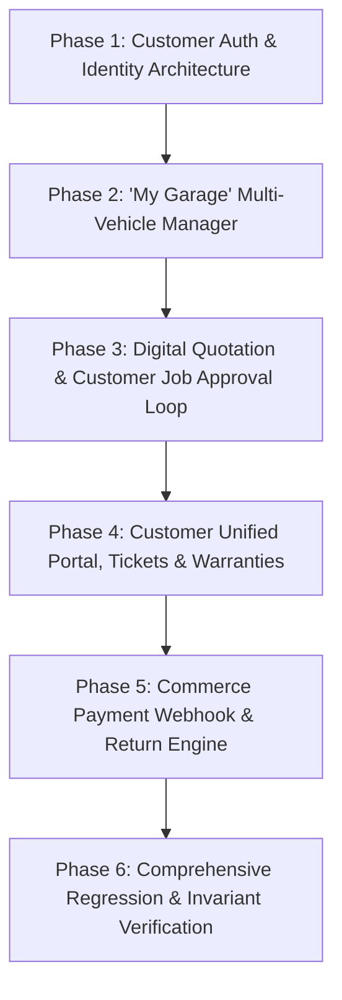

# WowCars — CTO Master Architecture Report, Gap Analysis & Product Roadmap
**Document Version:** 1.0.0 | **Author:** Chief Technology Officer & Principal Systems Architect | **Date:** October 31, 2026

---

## 1. Existing Application Architecture Report

### 1.1 Technical Stack & Infrastructure
- **Framework:** Next.js 16.4.3 (App Router with Turbopack, React 19, Cache Components, and Partial Prerendering enabled).
- **Language & Runtime:** TypeScript 5 (Strict Mode), Node.js 20+.
- **Database & Persistence Layer:**
  - `DatabaseAdapter` abstract interface (`src/lib/db/adapter.ts`) providing unified contract across 45+ domain methods.
  - `DatabaseStore` (`src/lib/db/store.ts`): ACID-compliant in-memory file-backed store with mutex synchronization, atomic writes, deep cloning, and automated JSON snapshots (`data/*.json`).
  - `MySqlStore` (`src/lib/db/mysqlStore.ts`): Production MySQL 8.0+ / MariaDB 10.3+ pool adapter with raw parameterized SQL and Invariant 15 fail-safe guard (refuses silent JSON fallback if MySQL is configured).
- **Authentication & Sessions:**
  - HMAC-SHA256 signed stateless session tokens (`wowcars_admin_session`, `wowcars_dealer_session`, `wowcars_seller_session`).
  - HttpOnly, SameSite, Secure cookie transmission.
  - PBKDF2 password hashing with random 16-byte salt (100,000 iterations).
  - CSRF protection: Same-origin verification on all state-changing `POST`, `PUT`, `PATCH`, `DELETE` requests.
- **Role-Based Access Control (RBAC):**
  - 13 distinct internal roles: `SUPER_ADMIN`, `OPERATIONS`, `DEALER_MANAGER`, `SUPPORT`, `ADMIN`, `VERIFICATION_OFFICER`, `MODERATOR`, `CRM_AGENT`, `MARKETING_MANAGER`, `PROCUREMENT_MANAGER`, `OUTLET_MANAGER`, `TECHNICIAN`, `FRANCHISE_USER`.
  - Least-privilege matrix (`src/lib/auth/permissions.ts`) strictly enforced server-side.
- **Design System:**
  - Premium dark automotive aesthetic with `#dc2626` (WowCars Red) accents, CSS Modules, Lucide icons, glassmorphism cards, and responsive layouts.

---

## 2. Functional Gap Analysis

| Business Division | Current Implementation Status | Gap / Missing Elements | Priority |
| :--- | :---: | :--- | :---: |
| **A. Used-Car Marketplace** | **Operational** | Buyer browsing, filters, seller submission (`/sell`), admin approval queue, dealer CRM. Missing vehicle reservation deposit flow and ownership transfer concierge status tracker. | High |
| **B. Spare-Parts Marketplace** | **Operational** | 7 core categories, SKU catalog, vehicle fitment tree, cart, checkout, order placement, order tracking by phone. Missing return/refund customer self-service request interface. | High |
| **C. Service Centres & Garages** | **Operational** | Public directory (`/service-centres`), fixed labour rate card, booking modal, admin job card lifecycle, technician assignment, stock decrement. Missing customer digital estimate approval portal. | High |
| **D. Customer Application & "My Garage"** | **Partially Implemented** | Currently only `/my-account/orders` phone lookup. **Missing unified Customer Portal, Mobile OTP auth, "My Garage" multi-vehicle manager, saved cars/parts, service reminders, and customer quotation approval.** | **Critical (P0)** |
| **E. Franchise & Expansion** | **Operational** | Public blueprint (`/franchise`), ROI calculator, application API (`/api/franchise/apply`), admin outlet creation modal. Missing digital franchise agreement repository. | Medium |
| **F. Supplier & Procurement** | **Operational** | Suppliers directory, quotations ranking, PO lifecycle, Goods Receipt Notes (GRN) with idempotency, Weighted Average Cost (WAC) recalculation. | Operational |
| **G. Multi-Outlet Inventory** | **Operational** | Outlet inventory isolation, inter-outlet stock transfers, provisional cost warnings, audit trail. | Operational |
| **H. Central Finance & BI** | **Operational** | P&L breakdown by division, scenario planning model, budget variance, tamper-evident CSV export. | Operational |

---

## 3. Database and API Gap Analysis

### 3.1 Database Gaps
The existing schema handles `dealers`, `sellers`, `admins`, `cars`, `enquiries`, `part_products`, `part_orders`, `suppliers`, `purchase_orders`, `goods_receipt_notes`, `inventory_items`, `job_cards`, and `outlets`.

**Missing Tables / Models Required:**
1. `customers`: Customer accounts with mobile number, email, full name, avatar, account status, default city/pincode, and notification preferences.
2. `customer_otps`: OTP authentication records with hashed OTP, expiration timestamp, attempt count, and rate-limiting metadata.
3. `customer_vehicles` (**"My Garage"**): Customer-owned vehicles with `customerId`, `make`, `model`, `generation`, `year`, `variant`, `fuelType`, `transmission`, `regNumber`, `odometerKm`, `lastServiceDate`, `nextServiceDueKm`, `insuranceExpiryDate`, `notes`.
4. `customer_saved_items`: Saved vehicles (from marketplace) and saved spare parts.
5. `customer_support_tickets`: Customer support requests, ticket category, messages thread, status (`OPEN`, `IN_PROGRESS`, `RESOLVED`, `CLOSED`), and assigned agent.
6. `order_return_requests`: Return and refund claims with order ID, product ID, return reason, proof images, status, and refund amount.
7. `payment_transactions`: Server-side payment records with gateway order ID, payment ID, signature, payment method, webhook status, and idempotency key.

### 3.2 API Gaps
**Missing Endpoints Required:**
- `POST /api/customer/auth/send-otp`: Sends 6-digit verification code to mobile number (rate-limited).
- `POST /api/customer/auth/verify-otp`: Validates OTP and issues customer session token (`wowcars_customer_session`).
- `GET /api/customer/auth/me`: Returns active customer profile and session metadata.
- `POST /api/customer/auth/logout`: Clears customer session cookie.
- `GET /api/customer/profile` & `PATCH /api/customer/profile`: Read/update customer name, email, addresses.
- `GET /api/customer/garage/vehicles`: Returns customer's saved vehicles in "My Garage".
- `POST /api/customer/garage/vehicles`: Adds a new vehicle to customer's garage with full specs.
- `DELETE /api/customer/garage/vehicles/[id]`: Removes a vehicle from garage.
- `GET /api/customer/garage/compatible-parts`: Auto-queries compatible parts for selected garage vehicle.
- `GET /api/customer/garage/appointments`: Returns customer's service bookings and job cards.
- `POST /api/customer/garage/appointments/[id]/approve`: Customer signs off on digital quote/estimate.
- `GET /api/customer/invoices`: Returns customer invoices across parts orders and garage job cards.
- `GET/POST /api/customer/tickets`: Customer support ticket creation and message history.

---

## 4. Security and Permission Review

1. **Customer Boundary Isolation:** Customer endpoints must strictly verify `customerId` from the decrypted session token. Customer A must NEVER be permitted to read or modify Customer B's vehicles, appointments, orders, or support tickets.
2. **OTP Security:**
   - 6-digit cryptographically secure random generation.
   - Expiration within 5 minutes.
   - Throttled to maximum 3 OTP requests per 10 minutes per IP/phone.
   - Maximum 3 incorrect verification attempts before invalidating the OTP.
3. **Data Privacy Barrier:** Public responses must continue sanitizing all internal wholesale costs, technician hourly pay, dealer supplier notes, and customer phone numbers.
4. **Idempotency Standards:** All payment callbacks, order placements, stock adjustments, and goods receipts must require unique idempotency keys.

---

## 5. Integration Dependency List

| Service | Provider / Target | Dev / Staging Mode | Production Configuration |
| :--- | :--- | :--- | :--- |
| **SMS / Mobile OTP** | MSG91 / Fast2SMS | Deterministic local OTP simulator (`123456` in development/test with audit logging) | Production REST API with DLT template registration |
| **Payment Gateway** | Razorpay / Cashfree | Verified mock signature validator with idempotency | Razorpay API Key ID + Secret + Webhook Secret |
| **WhatsApp Business** | WhatsApp Cloud API / Web Links | Verified pre-filled `https://wa.me/` deep-links | Meta Cloud API with webhook event ingestion |
| **Storage / Media** | File System / S3 | Local storage (`public/uploads/`) with binary magic byte validation | AWS S3 / Cloudflare R2 bucket with signed URLs |

---

## 6. Prioritised Implementation Roadmap

### Phase 1: Customer Authentication & Identity (P0)
- Add customer models (`Customer`, `CustomerOTP`, `CustomerSession`) to `src/lib/db/types.ts`.
- Implement store methods in both `DatabaseStore` and `MySqlStore`.
- Create `/api/customer/auth/send-otp`, `/verify-otp`, `/me`, `/logout`.
- Implement `authenticateCustomer` helper in `src/lib/auth/customerAuth.ts`.

### Phase 2: "My Garage" Multi-Vehicle Management (P0)
- Add `CustomerVehicle` data structure and persistence methods.
- Implement `/api/customer/garage/vehicles` CRUD endpoints.
- Build "My Garage" UI in `/my-account` allowing vehicle additions (Make, Model, Year, Fuel, Transmission, Reg No).
- Implement vehicle-specific fitment recommendations linked directly to the Spare Parts catalog.

### Phase 3: Digital Quotation & Service Approval Loop (P1)
- Add customer estimate approval endpoints (`POST /api/customer/garage/appointments/[id]/approve`).
- Connect Garage Job Cards in `/service-centres` and `/admin/operations` so customer approval state is synchronized in real time.
- Provide a customer approval interface showing itemized labour and parts breakdown.

### Phase 4: Unified Customer Portal, Support & Invoices (P1)
- Build unified `/my-account` tabs:
  1. Overview & Quick Stats
  2. My Garage (Vehicles)
  3. Service Appointments & Job Cards
  4. Spare Parts Orders & Tracking
  5. Invoices & Warranty Documents
  6. Support Tickets (`/api/customer/tickets`)
  7. Profile Settings
- Add support ticket creation and messaging flow.

### Phase 5: Payment Webhook & Return Engine (P2)
- Server-side signature verification module (`src/lib/payments/`).
- Idempotent payment webhook handler (`/api/payments/webhook`).
- Customer return & refund request endpoint (`/api/customer/orders/[id]/return`).

### Phase 6: Automated Regression & Invariant Testing (P0)
- Write automated test suite `scripts/test-customer-platform.ts`.
- Re-run all existing 121 tests to ensure zero regressions across marketplace, operations, dealer network, and security invariants.

---

## 7. Regression Test Plan

Every new phase must satisfy:
1. `npm run test:operations` (10/10 PASS)
2. `npm run test:spare-parts` (10/10 PASS)
3. `npm run test:invariants` (16/16 PASS)
4. `npm run test:smoke` (7/7 PASS)
5. `npm run test:admin` (6/6 PASS)
6. `npm run test:network` (45/45 PASS)
7. `npm run test:dealer-permissions` (11/11 PASS)
8. `npm run test:marketplace` (16/16 PASS)
9. New test suite `scripts/test-customer-platform.ts` (10/10 PASS)
10. `npx tsc --noEmit` (0 Errors)
11. `npm run lint` (0 Errors)
12. `npm run build` (120+ routes compiled with 0 errors)
