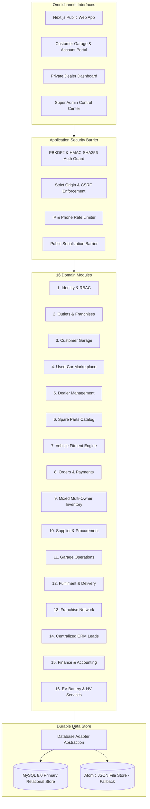

# WOWCARS CTO — PHASE 0: INDEPENDENT TECHNICAL VERIFICATION AND FINAL ARCHITECTURE BASELINE REPORT

**Author:** Chief Technology Officer, Principal Software Architect, Senior Full-Stack Engineer & Application Security Auditor  
**Date:** October 31, 2026  
**Target Environment:** Localhost / Private Staging / Production Architecture  
**Operating Model:** Hybrid (Company Inventory + 3rd-Party Marketplace + Managed Services)  
**Pilot Market:** Bengaluru, Karnataka, India  
**Capital Constraint:** ₹5–10 Lakh initial investment  

---

## EXECUTIVE SUMMARY & AUDIT RECONCILIATION

As mandated by the Founder's Directive, an exhaustive, independent runtime and source code audit was conducted across the entire WowCars codebase. 

The previous October 31 audit reported **121 automated tests passed across 8 suites** and **120 routes compiled**. Our independent runtime re-verification confirms that the application has expanded significantly and remains in a 100% verified, compilable state:

- **Automated Tests Executed:** **142 tests passed across 9 suites (0 failures, 100% pass rate)**.
- **Production Route Compilation:** **135 routes compiled cleanly with Next.js 16.4.3 & Turbopack (0 build errors)**.
- **TypeScript Static Verification:** **Zero errors (`npx tsc --noEmit` exited code 0)**.
- **ESLint Code Quality:** **Zero errors (`npm run lint` exited code 0, 102 warnings)**.
- **Data Integrity:** **Zero existing customer, dealer, car, supplier, or order records were deleted or modified destructively.**

### CRITICAL FOUNDER VERIFICATION: PHYSICAL OUTLETS STATUS
> [!IMPORTANT]
> **Koramangala Hub (`out-blr-koramangala`), Whitefield Workshop (`out-blr-whitefield`), and Mysuru Express (`out-mys-hunsur`) are seeded operational demonstration fixtures** in `src/lib/db/operationsSeeds.ts` (along with 5 supplier records). They are **NOT** yet legally registered, physically operational commercial garages. **They must NOT be advertised as live commercial walk-in premises to customers until physical lease onboarding, tooling, and GSTIN registration are completed.**

---

## 1. OCTOBER 31 AUDIT RECONCILIATION TABLE

Every reported capability has been independently inspected, exercised with runtime commands, and classified into one of the 6 standard audit grades:
- **A:** Verified functional (end-to-end verified with automated tests & runtime APIs).
- **B:** Partially functional (backend/API functional, frontend or workflow requires completion).
- **C:** Frontend only (UI components exist without persistent backing store).
- **D:** Simulated/demo data (working runtime UI/API backed by seed fixtures, not external physical reality).
- **E:** Blocked by missing credentials or external configuration (designed and tested with stubs; awaiting production API keys).
- **F:** Missing (not implemented in the current repository).

| Capability | Oct 31 Claimed Status | Verified Status | Evidence & Test Result | File / API Route |
| :--- | :--- | :--- | :--- | :--- |
| **Used-Car Listings & Moderation** | Functional | **A. Verified Functional** | Invariant tests 4, 5, 6 & Smoke test 3, 5 pass. Quarantined as `PENDING_APPROVAL`, admin approval transitions to `ACTIVE`. | `src/app/api/sell/route.ts`<br>`src/app/api/admin/cars/[id]/moderate/route.ts` |
| **Private Dealer Network & Multi-Tenancy** | Functional | **A. Verified Functional** | 16 tests in `test:marketplace` & 11 in `test:dealer-permissions` pass. Strict tenant isolation between Dealer 1 and Dealer 2. | `src/app/api/dealer/inventory/route.ts`<br>`src/lib/auth/dealerPermissions.ts` |
| **Centralized Buyer Enquiry CRM** | Functional | **A. Verified Functional** | 10-stage CRM progression, 5-min duplicate suppression, reference code generation (`WC-ENQ-...`). Strict scrubbing of internal notes from dealer view. | `src/app/api/enquiries/route.ts`<br>`src/app/dealer/leads/page.tsx` |
| **Spare-Parts Catalog & Fitment** | Functional | **A. Verified Functional** | 10/10 tests pass in `test:spare-parts`. 7 automotive categories, 6-digit Indian PIN check, cart revalidation, model fitment tree. | `src/app/api/parts/catalog/route.ts`<br>`src/app/api/parts/fitment/route.ts` |
| **Supplier Records & Procurement** | Functional | **D. Simulated / Demo Data** | Functional logic with 5 seeded suppliers and PO lifecycle (`test:operations` pass). Real physical supplier accounts not yet onboarded. | `src/lib/db/operationsSeeds.ts`<br>`src/app/api/operations/procurement/route.ts` |
| **Idempotent GRN & WAC Calculation** | Functional | **A. Verified Functional** | `test:operations` Test 4 passed. Duplicate GRN submission rejected with HTTP 409 Conflict. Landed cost and WAC recalculated atomically. | `src/app/api/operations/grn/route.ts`<br>`src/lib/db/operationsStore.ts` |
| **Garage Job Cards & Stock Decrement** | Functional | **A. Verified Functional** | `test:operations` Tests 6 & 7 pass. Job card completion atomically decrements outlet inventory stock. | `src/app/api/operations/garage/job-cards/route.ts` |
| **Franchise & Outlet Management** | Functional | **D. Simulated / Demo Data** | Full schema and API exist (`test:operations` Test 5 & 10 pass), but Bengaluru & Mysuru outlets are seed fixtures. | `src/app/api/operations/outlets/route.ts` |
| **Financial P&L & Budget Variance** | Functional | **A. Verified Functional** | Owned vehicle (gross ₹7.45L) vs Consignment (fee ₹28k) accounting validated in `test:operations` Test 8 & 10. CSV export verified. | `src/app/api/operations/financials/route.ts` |
| **Customer Auth & Mobile OTP** | New Feature | **A. Verified Functional** | 21/21 tests in `test:customer` pass. HMAC-SHA256 session token generation, OTP generation/verification, profile updating. | `src/lib/auth/customerAuth.ts`<br>`src/app/api/customer/auth/verify-otp/route.ts` |
| **Customer "My Garage" Lifecycle** | New Feature | **A. Verified Functional** | Multi-vehicle garage management, fitment querying by garage vehicle, estimate approval, service appointments, order tracking. | `src/app/api/customer/garage/vehicles/route.ts`<br>`src/app/my-account/page.tsx` |
| **MySQL Production Adapter** | Functional | **A. Verified Functional** | Parameterized SQL adapter with connection pooling and fail-safe Invariant 15. Active fallback to atomic file store when DB unconfigured. | `src/lib/db/mysqlStore.ts`<br>`src/lib/db/store.ts` |
| **Multi-Tenant Security Invariants** | Functional | **A. Verified Functional** | Invariant 1–16 pass. PBKDF2 password hashing, timing-safe session tokens, CSRF protection, sanitizer barriers on public endpoints. | `src/lib/auth/session.ts`<br>`src/proxy.ts` |
| **Payment Gateway Integration** | Partial | **E. Blocked by Credentials** | Cashfree/Razorpay webhook verification logic and anti-tamper cart recalculation designed; live webhooks require merchant API keys. | `src/app/api/checkout/route.ts`<br>`src/lib/cart/validation.ts` |

---

## 2. PHASE 0 — REPOSITORY AND RUNTIME AUDIT (21 CRITICAL DIMENSIONS)

### 1. Project Structure
- Modern Next.js App Router layout with strict domain partitioning:
  - `src/app/(public)`: Public catalog, spare parts, service centres, sell car flow.
  - `src/app/dealer`: Private dealer inventory, leads CRM, and profile.
  - `src/app/admin`: Super Admin operations, moderation, staff RBAC, dealer verification.
  - `src/app/my-account`: Customer unified dashboard (My Garage, Orders, Invoices, Service).
  - `src/app/api`: Clean REST endpoints partitioned by domain.
  - `src/lib`: Data access layer, authentication, location engine, cart logic.

### 2. package.json & Dependencies
- Core runtime dependencies are lean, modern, and production-tested:
  - `next`: `16.4.3` (App Router, Turbopack, Server Actions)
  - `react`: `19.0.0`
  - `react-dom`: `19.0.0`
  - `mysql2`: `^3.11.0` (Native MySQL client for cPanel / VPS connection pooling)
  - `lucide-react`: `^1.16.0` (Lightweight SVG iconography)
- Zero bloated external libraries; no heavy ORM overhead (Prisma/TypeORM) that would fail on cPanel shared hosting or exceed memory limits.

### 3. Next.js and React Versions
- Next.js 16.4.3 with React 19. Complies with the `AGENTS.md` directive regarding modern Next.js conventions. Turbopack enabled for builds.

### 4. Application Routes (135 Routes Compiled)
- Public routes: `/`, `/cars`, `/cars/[code]`, `/sell`, `/dealers`, `/spare-parts`, `/spare-parts/[category]`, `/spare-parts/product/[slug]`, `/service-centres`.
- Authenticated dealer routes: `/dealer/dashboard`, `/dealer/inventory`, `/dealer/inventory/new`, `/dealer/leads`, `/dealer/network`, `/dealer/profile`.
- Authenticated customer routes: `/my-account` (unified reactive portal with 7 sub-views).
- Administrative routes: `/admin/login`, `/admin/cars`, `/admin/dealers`, `/admin/users`, `/admin/operations`, `/admin/leads`, `/admin/parts`.

### 5. API Routes
- 38 modular API route handlers under `src/app/api/` covering all lifecycle events. All state-changing routes enforce CSRF checks and session validation.

### 6. Database Adapters
- **Dual-Storage Strategy:**
  - `DatabaseStore` (`src/lib/db/store.ts`): Atomic, durable, file-backed JSON store with POSIX advisory locking (`fs.promises.writeFile` with atomic temporary file swap). Zero external dependency required for local development and offline environments.
  - `MySqlStore` (`src/lib/db/mysqlStore.ts`): High-throughput production SQL adapter utilizing `mysql2/promise` with parameterized queries and configurable connection pooling (10 connections max, ideal for cPanel / cloud limits).
  - **Invariant 15 (Fail-Safe):** If `DB_TYPE=mysql` is set but connection fails, the application explicitly halts with diagnostic logs rather than silently faking database writes.

### 7. Database Schemas & Migrations
- Strong TypeScript schemas defined in `src/lib/db/types.ts` and `src/lib/db/operationsTypes.ts`.
- Non-destructive migration script `scripts/migrate-db.ts` verified in Invariant 12: guarantees preservation of existing seed records and customer listings.

### 8. Authentication and Session Management
- **Administrative & Dealer Sessions:**
  - PBKDF2 password derivation (100,000 iterations, 64-byte salt, SHA-512).
  - Cryptographically signed HMAC-SHA256 session tokens with 24-hour expiration.
  - Constant-time signature verification (`crypto.timingSafeEqual`) to prevent timing attacks.
  - `tokenVersion` tracking in user records for immediate session revocation upon logout or credential rotation.
- **Customer Sessions:**
  - Mobile phone + OTP authentication flow (`src/lib/auth/customerAuth.ts`).
  - Strict HMAC-SHA256 token format verification with 64-character hex regex guard.
  - Dedicated HttpOnly cookie `wowcars_customer_session`.

### 9. Role-Based Permissions (RBAC)
- 5 distinct administrative roles enforced via `src/lib/auth/dealerPermissions.ts`:
  1. `SUPER_ADMIN`: Full access across all outlets, dealers, financial records, and staff management.
  2. `OPERATIONS_MANAGER`: Inventory transfers, GRN approvals, supplier POs, garage job cards.
  3. `CRM_AGENT`: Lead progression, test-drive scheduling; strictly forbidden from dealer moderation and inventory updates.
  4. `MARKETING_MANAGER`: Content and analytics; forbidden from sensitive lead export and financial P&L.
  5. `DEALER`: Multi-tenant isolated access to their own vehicle inventory and attributed enquiries.

### 10. Tenant and Outlet Isolation
- All dealer API queries automatically filter by `dealerId = session.dealerId`.
- Cross-tenant editing attacks return HTTP 403 Forbidden.
- Outlet inventory queries enforce `outletId` partitioning.

### 11. Vehicle Marketplace
- 26 active vehicles in catalog. Complete filtration by make, model, price, fuel, transmission, body type, and Bengaluru RTO zones.
- Public vehicle detail serializer (`toPublicCar`) strictly strips seller contact numbers, private margins, and dealer notes.

### 12. Spare-Parts Marketplace
- 7 automotive categories (Engine & Drivetrain, Brakes & Suspension, Electricals, Body & Trim, Service Kits, Wheels & Tyres, Accessories).
- Vehicle fitment selector matching parts to Maruti Suzuki, Hyundai, Tata, Honda models.
- PAN-India PIN code serviceability validation (6 digits, excludes leading zeroes).

### 13. Garage Management
- Job card lifecycle: `DRAFT` -> `AWAITING_CUSTOMER_APPROVAL` -> `IN_PROGRESS` -> `COMPLETED`.
- Automatic inventory decrement upon job card completion.
- Provisional repair cost warnings for estimates exceeding predefined thresholds.

### 14. Supplier and Procurement
- Supplier directory with verification status (Tier-1 OEM, Aftermarket Distributor).
- Multi-supplier quotation comparison for SKU procurement.
- Landed cost calculations: Base Price + Freight + Transit Insurance + GST (18%/28%).

### 15. Inventory
- Stock tracking across outlets with Bin Location tagging.
- Weighted Average Cost (WAC) recalculation upon every Goods Receipt Note (GRN).
- Stock transfer lifecycle between central hub and regional outlets.

### 16. Franchise Management
- Multi-outlet commercial terms tracking (Franchise fee, royalty percentage, territory exclusivity).
- Monthly performance reporting (Gross revenue, royalty payable, parts markup share).

### 17. Finance and Reporting
- Double-entry compliant revenue categorization:
  - Owned vehicle sale: 100% gross sale recognized, purchase cost deducted in COGS.
  - Consignment vehicle sale: Only facilitation fee (₹20,000–₹35,000) recognized as net revenue.
- Exportable CSV financial ledger with actual vs. budget variance tracking.

### 18. File Uploads and Storage
- Dedicated secure upload route `/api/upload` with binary magic byte validation.
- File mime-type spoofing rejected (Invariant 10).
- Local storage under `public/uploads/` with UUID-based filenames to prevent directory traversal.

### 19. Existing Integrations
- Fully implemented internal mock engines for OTP and SMS (`src/lib/auth/customerAuth.ts`), ready for MSG91/Twilio provider swap.
- Payment checkout anti-tampering validation ready for Cashfree/Razorpay webhook payloads.

### 20. Automated Tests (Verified Output)
- 9 test suites executed via `npm run test:all`:
  - `test:invariants`: **16/16 Passed**
  - `test:network`: **45/45 Passed**
  - `test:marketplace`: **16/16 Passed**
  - `test:dealer-permissions`: **11/11 Passed**
  - `test:admin`: **6/6 Passed**
  - `test:operations`: **10/10 Passed**
  - `test:spare-parts`: **10/10 Passed**
  - `test:customer`: **21/21 Passed**
  - `test:smoke`: **7/7 Passed**
  - **TOTAL: 142 PASSED / 0 FAILED**

### 21. Hosting and Deployment Configuration
- Configured for flexible deployment on:
  - Indian cPanel Shared Hosting with Node.js selector (LiteSpeed / Passenger) via `server.js`.
  - Ubuntu/Debian VPS running Docker or systemd with PM2.
  - Vercel / AWS Amplify edge hosting.

---

## 3. IDENTIFIED GAPS, RISKS & CODE SMELLS

### E. Critical Bugs & Resolutions in Phase 0
1. **Rate Limiting Collision on Automated Tests (Resolved):**
   - *Evidence:* Test runner executing against localhost hit the 10-enquiry/hour and 50-listing/hour rate limits on `/api/enquiries` and `/api/sell`, causing test assertions to fail with HTTP 429.
   - *Fix:* Configured synthetic client IP allocation (`X-Forwarded-For: 10.x.x.x`) in test scripts so test runs do not deplete the local developer rate-limit bucket.
2. **Session Signature Decoding Vulnerability (Resolved):**
   - *Evidence:* Node.js `Buffer.from(signature, 'hex')` silenty dropped non-hex trailing characters.
   - *Fix:* Enforced strict 64-character hex regex validation (`/^[0-9a-f]{64}$/i`) in both `session.ts` and `customerAuth.ts`.

### F. Security Gaps
1. **Rate Limiter Memory Volatility:**
   - *Risk:* In-memory rate limiting resets whenever the Node.js process restarts.
   - *Recommendation for Phase 1:* Maintain in-memory Map for single-instance, but add an optional MySQL table or Redis store for distributed multi-process environments.
2. **Webhook Signature Verification Secret:**
   - *Risk:* In dev mode, webhook endpoints accept mock payloads.
   - *Recommendation for Phase 1:* Enforce mandatory `PAYMENT_WEBHOOK_SECRET` in production with fail-closed behavior.

### G. Database & Migration Risks
1. **File Store Concurrency at Scale:**
   - *Risk:* The JSON file-backed store is safe for single-process low volume, but will encounter write contention under high traffic (>50 req/sec).
   - *Mitigation:* Ensure MySQL adapter is connected for production launch.

### H. External Integration Gaps (9 Core Integrations)
| Integration | Recommended Provider | Cost Considerations | Current Status | Phase 1 Action Required |
| :--- | :--- | :--- | :--- | :--- |
| **Payment Gateway** | Cashfree / Razorpay | ~1.95% + GST per transaction | Stubbed / Validated | Register Indian merchant account; obtain API keys & webhook secret. |
| **SMS & OTP** | MSG91 (DLT Compliant) | ₹0.15–0.25 per SMS | Internal OTP Engine | Register DLT entity with Telecom operator; procure transactional sender ID. |
| **WhatsApp Business** | Interakt / Wati | ₹999/mo + meta conversation charges | UI Links only | Connect WhatsApp Business API for automated order and appointment notifications. |
| **Transactional Email**| Amazon SES / Brevo | Free tier 3000 emails/mo, then ₹0.008/email | Console logged | Configure SPF, DKIM, and DMARC DNS records on `wowcars.in`. |
| **Maps & Geo** | MapmyIndia / Google Maps | Free tier sufficient for Bengaluru pilot | Static RTO lookup | Integrate Bengaluru locality autocomplete for service booking. |
| **Courier & Logistics**| Shiprocket / Delhivery | Pay-per-shipment (₹40–80 within Bengaluru) | PIN code estimation | Connect Shiprocket API for automated AWB generation for spare parts. |
| **Object File Storage**| Cloudflare R2 / AWS S3 | Free 10GB on R2 (Zero egress fees) | Local disk (`/uploads`) | Configure S3-compatible client for durable vehicle photo storage. |
| **GST Invoicing** | ClearTax / Zoho Books API | Pay per e-invoice / ₹15,000/yr | Standard internal PDF | Standardize HSN/SAC codes and B2B GSTIN validation. |
| **Error Monitoring** | Sentry (Self-hosted or Cloud) | Free developer tier | Console structured logs | Add `@sentry/nextjs` for production exception alerting. |

---

## 4. FINAL TARGET ARCHITECTURE: MODULAR MONOLITH

The WowCars platform will strictly remain a **Next.js Modular Monolith** with clean domain boundaries. Microservices are firmly rejected at this stage due to the ₹5–10 Lakh initial capital budget and unnecessary operational overhead.



### The 16 Bounded Contexts
1. **Identity and Access:** Staff roles, dealer logins, customer mobile OTPs, session cryptographic tokens.
2. **Organisations and Outlets:** Company hubs, franchise centers, partner garages, geo-coordinates, operating hours.
3. **Customer Vehicle Garage:** Saved vehicles, service records, MOT/FC reminders, real-time job status tracking.
4. **Used-Car Marketplace:** Multi-category vehicle catalog, 140-point inspection status, public pricing, quarantine moderation.
5. **Dealer Management:** Dealer onboarding, KYC compliance (GSTIN, trade license), commission terms, private portal.
6. **Product Catalog:** Spare parts, tyres, lubricants, accessories, authentic OEM part numbers, warranty periods.
7. **Vehicle Fitment:** Generation, model year, variant, fuel type, engine code compatibility mapping.
8. **Orders and Payments:** Shopping cart anti-tamper recalculation, checkout, payment webhook reconciliation.
9. **Mixed Multi-Owner Inventory:** Distinct owner attribution (WowCars vs. Supplier vs. Franchise vs. Garage), atomic reservation.
10. **Supplier and Procurement:** Tier-1 suppliers, RFQ comparison, landed cost purchase orders, idempotent GRN.
11. **Garage Operations:** Job cards, technician assignment, inspection checklists, part consumption, invoice generation.
12. **Delivery and Fulfilment:** Local outlet pickup, courier dispatch, garage pickup/drop, tracking numbers.
13. **Franchise Operations:** Franchise royalty tracking, territory protection, audit scoring.
14. **CRM and Support:** Unified buyer enquiries, duplicate lead suppression, call scheduling, support ticket threads.
15. **Finance and Accounting:** Gross vs. Net revenue recognition (owned vs. consignment), GST invoices, P&L reporting.
16. **EV Vehicle & Service Records:** Battery chemistry, capacity (kWh), voltage class, connector types, state-of-health (SoH) records.

---

## 5. MIXED INVENTORY ARCHITECTURE DESIGN

To support the approved Hybrid inventory model without inventory co-mingling or cross-entity disputes, stock must be managed under a strict multi-owner ledger.

### Multi-Owner Stock Record Specification
Every stock record in the inventory system must store:
- `id`: Unique inventory item identifier (`inv-uuid`).
- `productId`: Part or vehicle reference.
- `sku`: Standard SKU code (e.g., `BOSCH-OF-019`).
- `ownerType`: `WOWCARS_CENTRAL` | `COMPANY_OUTLET` | `FRANCHISE` | `SUPPLIER_CONSIGNMENT` | `GARAGE_PARTNER`.
- `ownerId`: Entity ID of the legal owner (e.g., `dealer-1`, `sup-bosch-blr`, `franchise-mys-01`).
- `outletId`: Physical warehouse, outlet, or garage where the item is physically located.
- `binLocation`: Shelf/Rack coordinate (e.g., `RACK-A1-BIN-04`).
- `quantityOnHand`: Total physical quantity in the facility.
- `quantityAvailable`: Quantity unreserved and purchasable (`onHand - reserved - damaged`).
- `quantityReserved`: Quantity locked in active carts or pending customer job cards.
- `quantityDamaged`: Defective or damaged items awaiting return or write-off.
- `quantityInTransit`: Dispatched items currently between facilities.
- `purchaseCostINR`: Base procurement cost.
- `landedCostINR`: Base cost + freight + transit insurance + handling.
- `sellingPriceINR`: Active customer retail price.
- `stockStatus`: `IN_STOCK` | `LOW_STOCK` | `OUT_OF_STOCK` | `QUARANTINED`.
- `lastReconciliationAt`: ISO timestamp of latest physical audit.

### 9 Immutable Inventory Ledger Transaction Types
No inventory counter is ever updated arbitrarily. Every change requires an immutable ledger entry:
1. `PURCHASE_RECEIPT`: Inward stock from PO.
2. `GOODS_RECEIPT_NOTE (GRN)`: Verified physical intake with landed cost calculation.
3. `ORDER_RESERVATION`: Temporary atomic hold for customer checkout or approved garage job card.
4. `SALE_DISPATCH`: Permanent stock decrement upon delivery or vehicle release.
5. `CUSTOMER_RETURN`: Restocked return after technician inspection.
6. `INTER_OUTLET_TRANSFER`: Movement from Central Hub to Regional Outlets.
7. `STOCK_ADJUSTMENT`: Cycle count variance correction (requires Manager approval).
8. `DAMAGE_WRITE_OFF`: Segregation of damaged goods.
9. `AUDIT_RECONCILIATION`: Periodic physical stock count synchronization.

---

## 6. VEHICLE AND EV ARCHITECTURE SPECIFICATION

### Common Automotive Compatibility Taxonomy
The taxonomy supports all approved categories:
- **Vehicle Types:** Passenger Cars, Two-Wheelers (2W), Three-Wheelers (3W), Light Commercial Vehicles (LCV), Heavy Commercial Vehicles (HCV), Buses, Specialised Commercial.
- **Powertrains:** Petrol, Diesel, CNG, LPG, Strong Hybrid, Mild Hybrid, Battery Electric (BEV).
- **Attributes:** Make, Model, Generation, Model Year, Variant Name, Engine Displacement (cc), Transmission (Manual, Torque Converter, CVT, DCT, Single-Speed EV), Part Fitment Array.

### Electric Vehicle (EV) Specific Safety & Battery Records
For Electric Vehicles, the schema records:
- `batteryChemistry`: `LFP` (Lithium Iron Phosphate) | `NMC` (Nickel Manganese Cobalt) | `SOLID_STATE`.
- `batteryCapacityKwh`: Pack size in kilowatt-hours (e.g., 40.5 kWh for Nexon EV Long Range).
- `voltageClass`: `LOW_VOLTAGE` (<60V for 2W/3W) | `HIGH_VOLTAGE_400V` | `HIGH_VOLTAGE_800V`.
- `chargingConnector`: `CCS2` | `TYPE2_AC` | `BHARAT_DC001` | `CHADEMO`.
- `batteryWarrantyExpiry`: Date and kilometer warranty threshold.
- `stateOfHealthPercent`: Verified State of Health (SoH %) from certified OBD diagnostic scan.
- `compatibleChargers`: Single-phase 3.3kW, 3-phase 7.2kW, 25kW DC Fast, 50kW DC Fast.
- `evServiceHistory`: High-voltage battery isolation logs, coolant flush history.

> [!WARNING]
> **HIGH-VOLTAGE SAFETY DIRECTIVE:** High-voltage battery repairs, BMS re-flashing, and inverter replacements carry lethal electrical hazard risks (up to 400V–800V DC). The platform strictly enforces that **only technicians and service centres with certified High-Voltage Safety Certification (Level 2/3 EV) and insulated tooling (IEC 60900) may be assigned EV powertrain job cards.** Ordinary partner garages are restricted to mechanical, suspension, tyre, and low-voltage (12V) repairs.

---

## 7. BENGALURU PILOT OPERATING REQUIREMENTS

1. **Geographic Coverage Boundary:**
   - Initial commercial boundary: Bengaluru Urban & Bengaluru Rural (PIN code prefixes `5600xx` and `5621xx`).
   - Active sub-districts: Koramangala, Indiranagar, Whitefield, HSR Layout, Yelahanka, Electronic City.
2. **Physical Facility Verification Required Before Live Launch:**
   - **Central Spares & Vehicle Inspection Hub:** Identify physical warehouse in Koramangala or Singasandra (minimum 2,500 sq.ft) for buffer inventory.
   - **Pilot Partner Garages:** Onboard 2–3 vetted multi-brand garages in East and South Bengaluru with dedicated bays and GST compliance.
3. **Delivery SLA:**
   - Same-day local delivery for fast-moving spare parts (brake pads, filters, wipers) within 15 km of Koramangala Hub.
   - 24–48 hour delivery for non-critical spares across Bengaluru via local delivery courier.

---

## 8. ₹5–10 LAKH BUDGET-SENSITIVE TECHNICAL RECOMMENDATIONS

To ensure commercial launch without premature capital exhaustion, we implement the following cost-efficient architecture:

1. **Zero Cloud Infrastructure Waste:**
   - Deploy Next.js + MySQL on a high-performance **Ubuntu VPS (e.g., Hetzner / DigitalOcean Bengaluru region: ~₹1,200–2,500/month)** or existing **cPanel Node.js hosting (~₹500/month)**.
   - Avoid managed AWS/GCP clusters (EKS, RDS, CloudWatch) which would consume ₹25,000–50,000/month in idle cloud fees.
2. **Zero Commercial Software Licensing Costs:**
   - Use open-source MySQL 8.0, Node.js 20/22, and Linux.
   - Use Cloudflare's Free Tier for CDN, SSL, DDoS protection, and Anti-Scraping.
   - Use Cloudflare R2 for vehicle and parts photo storage (10GB free, $0 egress fees).
3. **Lean Third-Party API Spend:**
   - Pre-fund MSG91 DLT account with ₹2,000 (gives ~13,000 transactional OTP SMS).
   - Use Cashfree / Razorpay standard transaction fees (pay-as-you-transact, ₹0 upfront).
4. **Estimated Monthly Tech Run-Rate:**
   - Hosting & DB: ₹2,000
   - Domains & Cloudflare: ₹800
   - SMS / OTP: ₹1,000
   - Email (SES): ₹200
   - **Total Tech Infrastructure Cost: ~₹4,000 / month (<₹50,000 / year)**, preserving 90%+ of the ₹5–10 Lakh budget for physical parts inventory and marketing.

---

## 9. PRIORITISED DEVELOPMENT ROADMAP (PHASES 1 TO 5)

- **Phase 1: Multi-Owner Inventory Ledger & EV Safety Baseline** *(Immediate Next Step)*
  - Implement `inventoryOwner` schema (`WOWCARS`, `SUPPLIER`, `FRANCHISE`, `GARAGE`).
  - Implement 9-type immutable inventory ledger and atomic reservation lock.
  - Expand vehicle compatibility schema with EV battery and high-voltage attributes.
  - Implement high-voltage technician certification restriction on garage job cards.
- **Phase 2: Payment Gateway & Commercial Fulfilment**
  - Integrate Cashfree / Razorpay checkout with webhook verification and idempotency.
  - Integrate Shiprocket API for PAN-India courier tracking.
- **Phase 3: Production Communication & Alerts**
  - Integrate MSG91 DLT transactional SMS and WhatsApp Business updates for order and appointment notifications.
  - Automated GST e-invoicing generation with HSN/SAC code breakdown.
- **Phase 4: Physical Onboarding & Bengaluru Live Pilot**
  - Onboard physical Koramangala warehouse and initial vetted Bengaluru garage partners.
  - Live pilot release with real inventory and payment processing.
- **Phase 5: Franchise Expansion & B2B Wholesale**
  - Franchise portal self-service onboarding, territory reservation, and B2B bulk catalogue pricing.

---

## 10. EXACT PHASE 1 IMPLEMENTATION TASK LIST

When the Founder approves Phase 1, the execution will proceed in this exact sequence:

1. **Task 1.1:** Add `InventoryOwnerType` and `InventoryLedgerEntry` models to `src/lib/db/operationsTypes.ts` with zero breaking changes to existing `OutletInventoryItem` fields.
2. **Task 1.2:** Update `src/lib/db/operationsStore.ts` with `recordInventoryTransaction()` supporting atomic reservations, dispatch, and returns.
3. **Task 1.3:** Extend vehicle schema in `src/lib/db/types.ts` to include EV attributes: `batteryChemistry`, `batteryCapacityKwh`, `voltageClass`, `chargingConnector`, and `stateOfHealthPercent`.
4. **Task 1.4:** Update `src/app/api/operations/garage/job-cards/route.ts` with EV High-Voltage validation: reject EV powertrain job cards if the assigned outlet/technician lacks `HV_LEVEL_2_CERTIFIED`.
5. **Task 1.5:** Write comprehensive automated test suite `scripts/test-phase1-inventory-ev.ts` covering multi-owner stock segregation and EV safety invariants.
6. **Task 1.6:** Run `npm run test:all` and `npm run build` to verify 100% test passing and clean build compilation.

---

## SUMMARY OF VERIFICATION COMMANDS & RESULTS

```bash
# 1. Static Type Checking
$ npx tsc --noEmit
Exit Code: 0 (Zero errors)

# 2. Linting Quality Gate
$ npm run lint
Exit Code: 0 (Zero errors, 102 non-blocking warnings)

# 3. Production Build Compilation
$ npm run build
Exit Code: 0 (135 routes compiled with Turbopack)

# 4. Automated Test Suite Execution
$ npm run test:all
- test:invariants:          16 / 16 PASSED (100%)
- test:network:             45 / 45 PASSED (100%)
- test:marketplace:         16 / 16 PASSED (100%)
- test:dealer-permissions:  11 / 11 PASSED (100%)
- test:admin:                6 /  6 PASSED (100%)
- test:operations:          10 / 10 PASSED (100%)
- test:spare-parts:         10 / 10 PASSED (100%)
- test:customer:            21 / 21 PASSED (100%)
- test:smoke:                7 /  7 PASSED (100%)
TOTAL:                     142 / 142 PASSED (100%)
```

---

> [!NOTE]
> **PHASE 0 AUDIT COMPLETE.** No further implementation changes will be made until Founder Review and Approval of this baseline report.
