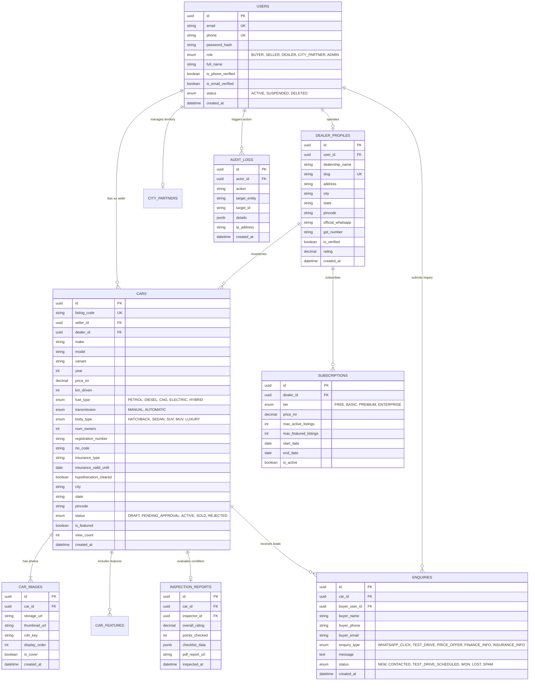

# WowCars — Relational Database Design & Schema Specification

**Document Version:** 1.0.0  
**Target Database Engines:** PostgreSQL 15+ / MySQL 8.0+ / MariaDB 10.5+  
**ORM:** Prisma ORM (Type-Safe Client & Automated Migrations)  

---

## 1. Entity Relationship Overview

The WowCars database is designed with strict relational integrity, ACID compliance, and foreign key cascades. It supports multi-role users (Buyers, Sellers, Dealers, City Partners, Admins), rich automotive vehicle specifications tailored for the Indian market (RTO codes, fuel types, owners, hypothecation), direct buyer inquiries, digital inspection reports, dealer subscriptions, and an immutable security audit log.



---

## 2. Table Specifications & DDL Definitions

### 2.1 Table: `users`
Central authentication and identity table.

| Column | Type | Constraints | Description |
|---|---|---|---|
| `id` | `UUID` / `VARCHAR(36)` | PRIMARY KEY, DEFAULT `gen_random_uuid()` | Unique user identifier |
| `email` | `VARCHAR(255)` | UNIQUE, NOT NULL | User's email address |
| `phone` | `VARCHAR(20)` | UNIQUE, NOT NULL | Mobile number (e.g., `+919019088160`) |
| `password_hash` | `VARCHAR(255)` | NOT NULL | Argon2id / bcrypt encrypted hash |
| `role` | `VARCHAR(30)` | NOT NULL, DEFAULT `'BUYER'` | Enum: `BUYER`, `SELLER`, `DEALER`, `CITY_PARTNER`, `ADMIN` |
| `full_name` | `VARCHAR(150)` | NOT NULL | Display name |
| `avatar_url` | `VARCHAR(500)` | NULL | Profile image URL |
| `is_phone_verified` | `BOOLEAN` | DEFAULT FALSE | Verified mobile number indicator |
| `is_email_verified` | `BOOLEAN` | DEFAULT FALSE | Email verification status |
| `status` | `VARCHAR(30)` | NOT NULL, DEFAULT `'ACTIVE'` | Enum: `ACTIVE`, `SUSPENDED`, `DELETED` |
| `last_login_at` | `TIMESTAMP WITH TIME ZONE` | NULL | Timestamp of last access |
| `created_at` | `TIMESTAMP WITH TIME ZONE` | DEFAULT CURRENT_TIMESTAMP | Record creation time |
| `updated_at` | `TIMESTAMP WITH TIME ZONE` | DEFAULT CURRENT_TIMESTAMP | Automatically updated |

### 2.2 Table: `dealer_profiles`
Stores dealership business details, physical address, and verification status.

| Column | Type | Constraints | Description |
|---|---|---|---|
| `id` | `UUID` | PRIMARY KEY | Unique dealer profile ID |
| `user_id` | `UUID` | UNIQUE, NOT NULL, FK(`users.id` ON DELETE CASCADE) | Linked user account |
| `dealership_name`| `VARCHAR(200)` | NOT NULL | Commercial trade name |
| `slug` | `VARCHAR(220)` | UNIQUE, NOT NULL | SEO URL slug (e.g., `sri-balaji-motors-yelahanka`) |
| `logo_url` | `VARCHAR(500)` | NULL | Dealership logo image |
| `address_line1` | `VARCHAR(255)` | NOT NULL | Street / Landmark address |
| `city` | `VARCHAR(100)` | NOT NULL | City (e.g., `Bengaluru`) |
| `state` | `VARCHAR(100)` | NOT NULL | State (e.g., `Karnataka`) |
| `pincode` | `VARCHAR(10)` | NOT NULL | Postal Code (e.g., `560064`) |
| `official_whatsapp`| `VARCHAR(20)` | NOT NULL | Verified WhatsApp business number |
| `gst_number` | `VARCHAR(20)` | NULL | Indian GSTIN (if registered) |
| `trade_license_no`| `VARCHAR(50)` | NULL | Local municipal trade license |
| `is_verified` | `BOOLEAN` | DEFAULT FALSE | Admin verification checkmark |
| `verified_at` | `TIMESTAMP WITH TIME ZONE`| NULL | Date of verification |
| `verified_by_user_id`| `UUID` | NULL, FK(`users.id`) | Admin who performed verification |
| `rating` | `NUMERIC(3,2)` | DEFAULT 5.00 | Average buyer rating (0.00 to 5.00) |
| `created_at` | `TIMESTAMP WITH TIME ZONE`| DEFAULT CURRENT_TIMESTAMP | Creation time |
| `updated_at` | `TIMESTAMP WITH TIME ZONE`| DEFAULT CURRENT_TIMESTAMP | Update time |

### 2.3 Table: `cars`
Primary inventory table designed specifically for Indian used vehicle specifications.

| Column | Type | Constraints | Description |
|---|---|---|---|
| `id` | `UUID` | PRIMARY KEY | Unique car listing ID |
| `listing_code` | `VARCHAR(20)` | UNIQUE, NOT NULL | Human-readable short ID (e.g., `WC-1049`) |
| `seller_id` | `UUID` | NOT NULL, FK(`users.id`) | Owner who created listing |
| `dealer_id` | `UUID` | NULL, FK(`dealer_profiles.id`) | Populated if listed by a verified dealer |
| `make` | `VARCHAR(100)` | NOT NULL | Brand (e.g., `Hyundai`, `Maruti Suzuki`, `Tata`, `Toyota`) |
| `model` | `VARCHAR(100)` | NOT NULL | Model (e.g., `Creta`, `Baleno`, `Nexon`, `Innova Crysta`) |
| `variant` | `VARCHAR(100)` | NOT NULL | Trim/Variant (e.g., `1.5 SX (O) Diesel AT`) |
| `year` | `SMALLINT` | NOT NULL | Year of manufacture (e.g., `2021`) |
| `price_inr` | `NUMERIC(12,2)` | NOT NULL | Asking price in Indian Rupees |
| `km_driven` | `INTEGER` | NOT NULL | Odometer reading in kilometers |
| `fuel_type` | `VARCHAR(30)` | NOT NULL | Enum: `PETROL`, `DIESEL`, `CNG`, `ELECTRIC`, `HYBRID` |
| `transmission` | `VARCHAR(30)` | NOT NULL | Enum: `MANUAL`, `AUTOMATIC` |
| `body_type` | `VARCHAR(30)` | NOT NULL | Enum: `HATCHBACK`, `SEDAN`, `SUV`, `MUV`, `LUXURY` |
| `color` | `VARCHAR(50)` | NOT NULL | Exterior color (e.g., `Polar White`, `Phantom Black`) |
| `num_owners` | `SMALLINT` | NOT NULL, DEFAULT 1 | 1 = 1st Owner, 2 = 2nd Owner, etc. |
| `registration_number`| `VARCHAR(20)` | NOT NULL | Vehicle Reg (e.g., `KA04MW1234`) |
| `rto_code` | `VARCHAR(10)` | NOT NULL | RTO identifier (e.g., `KA-04`, `KA-50`) |
| `insurance_type`| `VARCHAR(50)` | NOT NULL | `Comprehensive`, `Zero Dep`, `Third Party`, `Expired` |
| `insurance_valid_until`| `DATE` | NULL | Insurance expiry date |
| `hypothecation_cleared`| `BOOLEAN` | DEFAULT TRUE | True if no pending bank loan/hypothecation |
| `rto_noc_available`| `BOOLEAN` | DEFAULT FALSE | Inter-state transfer NOC ready |
| `title` | `VARCHAR(255)` | NOT NULL | Auto-generated or custom SEO listing title |
| `description` | `TEXT` | NOT NULL | Detailed condition & vehicle highlights |
| `city` | `VARCHAR(100)` | NOT NULL | Location city (e.g., `Bengaluru`) |
| `locality` | `VARCHAR(150)` | NULL | Sub-locality (e.g., `Yelahanka New Town`) |
| `state` | `VARCHAR(100)` | NOT NULL, DEFAULT `'Karnataka'` | State |
| `pincode` | `VARCHAR(10)` | NOT NULL | Pincode (e.g., `560064`) |
| `status` | `VARCHAR(30)` | NOT NULL, DEFAULT `'PENDING_APPROVAL'` | Enum: `DRAFT`, `PENDING_APPROVAL`, `ACTIVE`, `SOLD`, `REJECTED` |
| `rejection_reason`| `TEXT` | NULL | Admin explanation if rejected |
| `is_featured` | `BOOLEAN` | DEFAULT FALSE | Featured top placement badge |
| `view_count` | `INTEGER` | DEFAULT 0 | Total page views counter |
| `created_at` | `TIMESTAMP WITH TIME ZONE`| DEFAULT CURRENT_TIMESTAMP | Created timestamp |
| `updated_at` | `TIMESTAMP WITH TIME ZONE`| DEFAULT CURRENT_TIMESTAMP | Updated timestamp |

### 2.4 Table: `car_images`
Stores Cloudflare R2 / Object storage references for all vehicle photos.

| Column | Type | Constraints | Description |
|---|---|---|---|
| `id` | `UUID` | PRIMARY KEY | Unique image ID |
| `car_id` | `UUID` | NOT NULL, FK(`cars.id` ON DELETE CASCADE) | Parent vehicle |
| `storage_url` | `VARCHAR(600)` | NOT NULL | Full CDN URL of optimized WebP image |
| `thumbnail_url`| `VARCHAR(600)` | NOT NULL | Small thumbnail CDN URL (400x300) |
| `storage_key` | `VARCHAR(255)` | NOT NULL | R2/S3 object key for deletion |
| `caption` | `VARCHAR(100)` | NULL | e.g., `Front Right Angle`, `Odometer Reading` |
| `display_order`| `SMALLINT` | NOT NULL, DEFAULT 0 | Sort order in carousel |
| `is_cover` | `BOOLEAN` | DEFAULT FALSE | Main thumbnail on search cards |
| `created_at` | `TIMESTAMP WITH TIME ZONE`| DEFAULT CURRENT_TIMESTAMP | Upload timestamp |

### 2.5 Table: `enquiries`
Tracks all buyer interest, leads, test drive bookings, and loan/insurance inquiries.

| Column | Type | Constraints | Description |
|---|---|---|---|
| `id` | `UUID` | PRIMARY KEY | Unique inquiry ID |
| `car_id` | `UUID` | NOT NULL, FK(`cars.id` ON DELETE CASCADE) | Car of interest |
| `buyer_user_id`| `UUID` | NULL, FK(`users.id` ON DELETE SET NULL) | Populated if logged in |
| `buyer_name` | `VARCHAR(150)` | NOT NULL | Inquiring buyer's full name |
| `buyer_phone` | `VARCHAR(20)` | NOT NULL | Mobile number |
| `buyer_email` | `VARCHAR(255)` | NULL | Optional email |
| `enquiry_type` | `VARCHAR(50)` | NOT NULL | Enum: `WHATSAPP_CLICK`, `TEST_DRIVE`, `PRICE_OFFER`, `FINANCE_INFO`, `INSURANCE_INFO` |
| `message` | `TEXT` | NULL | Buyer notes or preferred test drive time |
| `preferred_date`| `DATE` | NULL | Requested date for test drive |
| `status` | `VARCHAR(30)` | NOT NULL, DEFAULT `'NEW'` | Enum: `NEW`, `CONTACTED`, `SCHEDULED`, `CLOSED_WON`, `CLOSED_LOST`, `SPAM` |
| `admin_notes` | `TEXT` | NULL | Internal operations notes |
| `created_at` | `TIMESTAMP WITH TIME ZONE`| DEFAULT CURRENT_TIMESTAMP | Inquiry submission time |

### 2.6 Table: `inspection_reports`
Detailed physical condition evaluation conducted by WowCars inspectors or certified partners.

| Column | Type | Constraints | Description |
|---|---|---|---|
| `id` | `UUID` | PRIMARY KEY | Unique report ID |
| `car_id` | `UUID` | UNIQUE, NOT NULL, FK(`cars.id` ON DELETE CASCADE) | Inspected vehicle |
| `inspector_id` | `UUID` | NOT NULL, FK(`users.id`) | Inspector user account |
| `overall_rating`| `NUMERIC(3,1)`| NOT NULL | Score out of 10.0 (e.g., `8.7`) |
| `points_checked`| `INTEGER` | NOT NULL, DEFAULT 150 | Total checklist points (e.g., 150) |
| `engine_score` | `NUMERIC(3,1)`| NOT NULL | Sub-score out of 10 |
| `transmission_score`| `NUMERIC(3,1)`| NOT NULL | Sub-score out of 10 |
| `chassis_body_score`| `NUMERIC(3,1)`| NOT NULL | Sub-score out of 10 |
| `tyres_score` | `NUMERIC(3,1)`| NOT NULL | Sub-score out of 10 |
| `electricals_score`| `NUMERIC(3,1)`| NOT NULL | Sub-score out of 10 |
| `checklist_data`| `JSONB` / `TEXT`| NOT NULL | Complete 150-point JSON checklist |
| `pdf_report_url`| `VARCHAR(600)`| NULL | Downloadable PDF report on R2 |
| `inspected_at` | `TIMESTAMP WITH TIME ZONE`| DEFAULT CURRENT_TIMESTAMP | Inspection date |

### 2.7 Table: `subscriptions`
Dealer subscription tiers for platform monetization (Activated in Phase 2).

| Column | Type | Constraints | Description |
|---|---|---|---|
| `id` | `UUID` | PRIMARY KEY | Unique subscription ID |
| `dealer_id` | `UUID` | NOT NULL, FK(`dealer_profiles.id`) | Dealership |
| `tier` | `VARCHAR(50)` | NOT NULL | Enum: `FREE`, `STARTER`, `PRO`, `ENTERPRISE` |
| `monthly_price_inr`| `NUMERIC(10,2)`| NOT NULL | Plan price in INR (e.g., ₹0 for MVP, ₹2,499 for Pro) |
| `max_active_listings`| `INTEGER` | NOT NULL | e.g., 5 for Free, 25 for Starter, 100 for Pro |
| `max_featured_listings`| `INTEGER`| NOT NULL | Number of high-priority spotlight listings |
| `start_date` | `DATE` | NOT NULL | Subscription period start |
| `end_date` | `DATE` | NOT NULL | Subscription period end |
| `payment_status`| `VARCHAR(30)` | NOT NULL, DEFAULT `'ACTIVE'` | `ACTIVE`, `EXPIRED`, `PENDING_RENEWAL` |
| `created_at` | `TIMESTAMP WITH TIME ZONE`| DEFAULT CURRENT_TIMESTAMP | Creation time |

### 2.8 Table: `audit_logs`
Immutable compliance and security ledger.

| Column | Type | Constraints | Description |
|---|---|---|---|
| `id` | `UUID` | PRIMARY KEY | Unique log ID |
| `actor_id` | `UUID` | NULL, FK(`users.id` ON DELETE SET NULL) | User performing action (or NULL if system) |
| `action` | `VARCHAR(100)` | NOT NULL | e.g., `CAR_APPROVED`, `PRICE_CHANGED`, `LOGIN_FAILED` |
| `target_entity`| `VARCHAR(50)` | NOT NULL | e.g., `cars`, `users`, `dealers` |
| `target_id` | `VARCHAR(50)` | NOT NULL | Primary key of affected record |
| `details` | `JSONB` / `TEXT`| NULL | Old values, new values, reasons |
| `ip_address` | `VARCHAR(50)` | NULL | Client IP address |
| `user_agent` | `VARCHAR(300)` | NULL | Browser / device string |
| `created_at` | `TIMESTAMP WITH TIME ZONE`| DEFAULT CURRENT_TIMESTAMP | Immutable log time |

---

## 3. High-Performance Indexing Strategy

To guarantee search queries complete in under 50ms across thousands of listings:

1. **Composite Search Index (City + Status + Make + Model + Price):**
   ```sql
   CREATE INDEX idx_cars_search_composite 
   ON cars(city, status, make, model, price_inr);
   ```
2. **Filtering B-Tree Indexes:**
   ```sql
   CREATE INDEX idx_cars_status_featured ON cars(status, is_featured, created_at DESC);
   CREATE INDEX idx_cars_fuel_transmission ON cars(fuel_type, transmission);
   CREATE INDEX idx_cars_budget ON cars(price_inr);
   CREATE INDEX idx_cars_year_km ON cars(year DESC, km_driven ASC);
   CREATE INDEX idx_cars_seller ON cars(seller_id);
   CREATE INDEX idx_cars_dealer ON cars(dealer_id);
   ```
3. **Full-Text Search Index (PostgreSQL):**
   ```sql
   CREATE INDEX idx_cars_fulltext ON cars 
   USING GIN (to_tsvector('english', make || ' ' || model || ' ' || variant || ' ' || city));
   ```
4. **Dealer Slug Fast Lookup:**
   ```sql
   CREATE UNIQUE INDEX idx_dealer_slug ON dealer_profiles(slug);
   ```

---

## 4. Privacy & Data Protection Compliance (India DPDPA 2023)

Under the Digital Personal Data Protection Act (2023) enacted in India:
1. **Phone Number Privacy:** Individual seller phone numbers are **never rendered as plain text in client-side HTML source**. Direct contacts are mediated via pre-approved WhatsApp links with optional concierge masking.
2. **Right to Erasure (Data Minimization):** When an individual seller marks a vehicle as sold, registration plate numbers are anonymized or masked from public view after 30 days.
3. **Consent Logging:** All lead generation forms store an explicit consent timestamp (`consent_given_at: TIMESTAMP`) confirming the buyer requested car seller contact.
