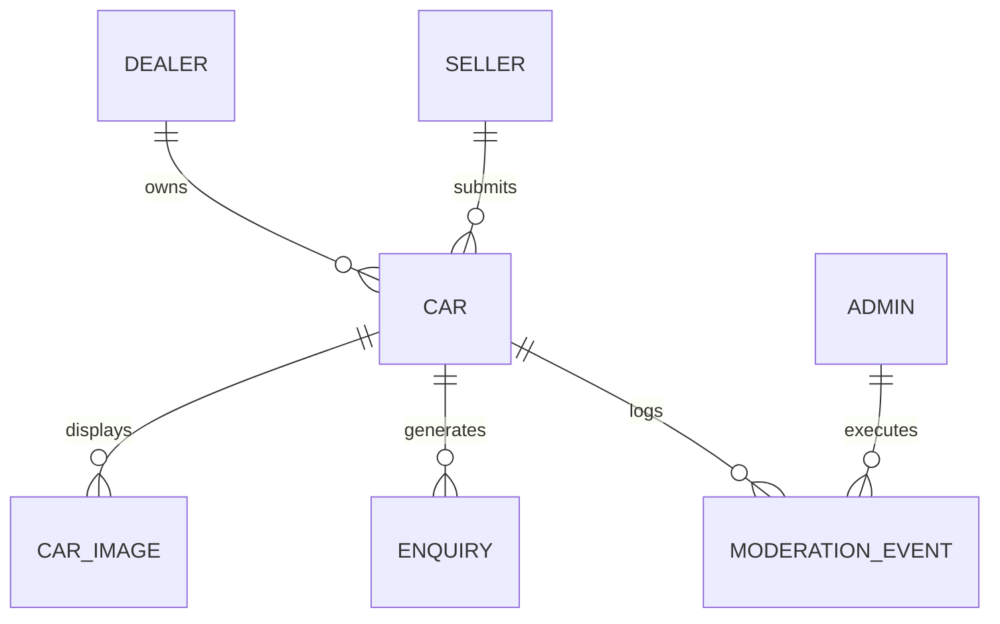

# WowCars — Minimal Normalized Database Architecture & Implementation Plan

**Document Version:** 1.0.0  
**Target Environment:** cPanel MySQL / MariaDB (Zero-Budget Production Release)  
**ORM / Driver Status:** Native PDO MySQL (Zero dependency overhead; migration-ready for Prisma ORM when cloud database is funded)  
**Date:** 2026-10-28  

---

## 1. Minimal Production Scope vs. Deferred Architecture

To achieve a stable, secure pilot launch with ₹0 investment, we intentionally eliminate enterprise bloat (complex OBD diagnostics JSON, franchise tiering, multi-tiered subscription billing, and AI valuation microservices) and focus strictly on the **6 normalized core tables** required for the marketplace to function:



1. **`dealers`**: Independent verified showroom partners in Bengaluru.
2. **`sellers`**: Private vehicle owners submitting cars via `/sell`.
3. **`cars`**: The vehicle inventory (make, model, year, price, RTO code, approval status).
4. **`car_images`**: High-resolution exterior and interior photo URLs per vehicle.
5. **`enquiries`**: Buyer leads, test-drive booking requests, and loan inquiry logs.
6. **`admins` & `moderation_events`**: Secure password-protected administrative review and approval logs.

---

## 2. Complete, Production-Ready SQL Schema (DDL)

Copy and paste this script directly into **phpMyAdmin -> SQL tab** inside cPanel to create the entire database structure in under 5 seconds:

```sql
-- WowCars MVP Database Schema Specification (MySQL 5.7+ / MariaDB 10.3+)
-- Character set: UTF8MB4 (full emoji and international character support)

SET FOREIGN_KEY_CHECKS = 0;

-- 1. DEALERS TABLE
CREATE TABLE IF NOT EXISTS `dealers` (
  `id` VARCHAR(36) NOT NULL,
  `name` VARCHAR(150) NOT NULL,
  `slug` VARCHAR(150) NOT NULL UNIQUE,
  `locality` VARCHAR(100) NOT NULL,
  `address` TEXT NOT NULL,
  `rating` DECIMAL(3, 2) NOT NULL DEFAULT 5.00,
  `reviews_count` INT NOT NULL DEFAULT 0,
  `whatsapp_number` VARCHAR(20) NOT NULL,
  `established_year` INT NOT NULL DEFAULT 2018,
  `is_verified` BOOLEAN NOT NULL DEFAULT TRUE,
  `created_at` TIMESTAMP NOT NULL DEFAULT CURRENT_TIMESTAMP,
  PRIMARY KEY (`id`),
  INDEX `idx_dealers_slug` (`slug`),
  INDEX `idx_dealers_locality` (`locality`)
) ENGINE=InnoDB DEFAULT CHARSET=utf8mb4 COLLATE=utf8mb4_unicode_ci;

-- 2. PRIVATE SELLERS TABLE
CREATE TABLE IF NOT EXISTS `sellers` (
  `id` VARCHAR(36) NOT NULL,
  `full_name` VARCHAR(150) NOT NULL,
  `phone` VARCHAR(20) NOT NULL,
  `whatsapp` VARCHAR(20) NOT NULL,
  `email` VARCHAR(150) NULL,
  `city` VARCHAR(80) NOT NULL DEFAULT 'Bengaluru',
  `created_at` TIMESTAMP NOT NULL DEFAULT CURRENT_TIMESTAMP,
  PRIMARY KEY (`id`),
  INDEX `idx_sellers_phone` (`phone`)
) ENGINE=InnoDB DEFAULT CHARSET=utf8mb4 COLLATE=utf8mb4_unicode_ci;

-- 3. CAR LISTINGS TABLE
CREATE TABLE IF NOT EXISTS `cars` (
  `id` VARCHAR(36) NOT NULL,
  `listing_code` VARCHAR(20) NOT NULL UNIQUE,
  `seller_id` VARCHAR(36) NULL,
  `dealer_id` VARCHAR(36) NULL,
  `seller_type` ENUM('Individual', 'Verified Dealer') NOT NULL DEFAULT 'Individual',
  `make` VARCHAR(80) NOT NULL,
  `model` VARCHAR(80) NOT NULL,
  `variant` VARCHAR(120) NOT NULL,
  `year` INT NOT NULL,
  `price_inr` DECIMAL(12, 2) NOT NULL,
  `km_driven` INT NOT NULL,
  `fuel_type` ENUM('Petrol', 'Diesel', 'CNG', 'Electric', 'Hybrid') NOT NULL,
  `transmission` ENUM('Manual', 'Automatic') NOT NULL,
  `body_type` ENUM('Hatchback', 'Sedan', 'SUV', 'MUV', 'Luxury') NOT NULL,
  `color` VARCHAR(50) NOT NULL,
  `num_owners` INT NOT NULL DEFAULT 1,
  `rto_code` VARCHAR(20) NOT NULL,
  `rto_area` VARCHAR(100) NOT NULL,
  `insurance_type` VARCHAR(80) NOT NULL DEFAULT 'Comprehensive',
  `insurance_validity` VARCHAR(80) NULL,
  `city` VARCHAR(80) NOT NULL DEFAULT 'Bengaluru',
  `locality` VARCHAR(100) NOT NULL,
  `status` ENUM('DRAFT', 'PENDING_APPROVAL', 'ACTIVE', 'SOLD', 'REJECTED') NOT NULL DEFAULT 'PENDING_APPROVAL',
  `rejection_reason` TEXT NULL,
  `is_verified` BOOLEAN NOT NULL DEFAULT FALSE,
  `is_featured` BOOLEAN NOT NULL DEFAULT FALSE,
  `overview` TEXT NULL,
  `created_at` TIMESTAMP NOT NULL DEFAULT CURRENT_TIMESTAMP,
  `updated_at` TIMESTAMP NOT NULL DEFAULT CURRENT_TIMESTAMP ON UPDATE CURRENT_TIMESTAMP,
  PRIMARY KEY (`id`),
  INDEX `idx_cars_catalog` (`status`, `city`, `make`, `body_type`, `price_inr`),
  INDEX `idx_cars_featured` (`status`, `is_featured`, `created_at`),
  INDEX `idx_cars_listing_code` (`listing_code`),
  CONSTRAINT `fk_cars_seller` FOREIGN KEY (`seller_id`) REFERENCES `sellers` (`id`) ON DELETE SET NULL,
  CONSTRAINT `fk_cars_dealer` FOREIGN KEY (`dealer_id`) REFERENCES `dealers` (`id`) ON DELETE SET NULL
) ENGINE=InnoDB DEFAULT CHARSET=utf8mb4 COLLATE=utf8mb4_unicode_ci;

-- 4. CAR IMAGES TABLE
CREATE TABLE IF NOT EXISTS `car_images` (
  `id` VARCHAR(36) NOT NULL,
  `car_id` VARCHAR(36) NOT NULL,
  `image_url` VARCHAR(500) NOT NULL,
  `display_order` INT NOT NULL DEFAULT 0,
  `is_cover` BOOLEAN NOT NULL DEFAULT FALSE,
  `created_at` TIMESTAMP NOT NULL DEFAULT CURRENT_TIMESTAMP,
  PRIMARY KEY (`id`),
  INDEX `idx_car_images_car` (`car_id`, `display_order`),
  CONSTRAINT `fk_images_car` FOREIGN KEY (`car_id`) REFERENCES `cars` (`id`) ON DELETE CASCADE
) ENGINE=InnoDB DEFAULT CHARSET=utf8mb4 COLLATE=utf8mb4_unicode_ci;

-- 5. BUYER ENQUIRIES & LEADS TABLE
CREATE TABLE IF NOT EXISTS `enquiries` (
  `id` VARCHAR(36) NOT NULL,
  `car_id` VARCHAR(36) NOT NULL,
  `buyer_name` VARCHAR(150) NOT NULL,
  `buyer_phone` VARCHAR(20) NOT NULL,
  `enquiry_type` ENUM('WHATSAPP_CLICK', 'TEST_DRIVE_REQUEST', 'CALLBACK_REQUEST', 'LOAN_INQUIRY') NOT NULL DEFAULT 'WHATSAPP_CLICK',
  `preferred_date` DATE NULL,
  `preferred_slot` VARCHAR(50) NULL,
  `notes` TEXT NULL,
  `status` ENUM('NEW', 'CONTACTED', 'CONVERTED', 'LOST') NOT NULL DEFAULT 'NEW',
  `created_at` TIMESTAMP NOT NULL DEFAULT CURRENT_TIMESTAMP,
  PRIMARY KEY (`id`),
  INDEX `idx_enquiries_car` (`car_id`, `status`),
  INDEX `idx_enquiries_date` (`created_at`),
  CONSTRAINT `fk_enquiries_car` FOREIGN KEY (`car_id`) REFERENCES `cars` (`id`) ON DELETE CASCADE
) ENGINE=InnoDB DEFAULT CHARSET=utf8mb4 COLLATE=utf8mb4_unicode_ci;

-- 6. ADMINISTRATORS TABLE
CREATE TABLE IF NOT EXISTS `admins` (
  `id` VARCHAR(36) NOT NULL,
  `username` VARCHAR(80) NOT NULL UNIQUE,
  `password_hash` VARCHAR(255) NOT NULL,
  `full_name` VARCHAR(120) NOT NULL,
  `is_active` BOOLEAN NOT NULL DEFAULT TRUE,
  `last_login_at` TIMESTAMP NULL,
  `created_at` TIMESTAMP NOT NULL DEFAULT CURRENT_TIMESTAMP,
  PRIMARY KEY (`id`),
  INDEX `idx_admins_username` (`username`)
) ENGINE=InnoDB DEFAULT CHARSET=utf8mb4 COLLATE=utf8mb4_unicode_ci;

-- 7. AUDIT & MODERATION EVENTS TABLE
CREATE TABLE IF NOT EXISTS `moderation_events` (
  `id` VARCHAR(36) NOT NULL,
  `car_id` VARCHAR(36) NOT NULL,
  `admin_id` VARCHAR(36) NOT NULL,
  `action` ENUM('APPROVED', 'REJECTED', 'MARKED_SOLD', 'RESTORED') NOT NULL,
  `notes` TEXT NULL,
  `created_at` TIMESTAMP NOT NULL DEFAULT CURRENT_TIMESTAMP,
  PRIMARY KEY (`id`),
  INDEX `idx_moderation_car` (`car_id`),
  CONSTRAINT `fk_mod_car` FOREIGN KEY (`car_id`) REFERENCES `cars` (`id`) ON DELETE CASCADE,
  CONSTRAINT `fk_mod_admin` FOREIGN KEY (`admin_id`) REFERENCES `admins` (`id`) ON DELETE CASCADE
) ENGINE=InnoDB DEFAULT CHARSET=utf8mb4 COLLATE=utf8mb4_unicode_ci;

SET FOREIGN_KEY_CHECKS = 1;
```

---

## 3. Initial Seed Data (Bengaluru Verified Showrooms & Inventory)

To populate the database with initial verified listings (matching our current verified mock dataset), run:

```sql
-- Seed Dealers
INSERT INTO `dealers` (`id`, `name`, `slug`, `locality`, `address`, `rating`, `reviews_count`, `whatsapp_number`, `established_year`) VALUES
('dealer-1', 'Sri Balaji Motors', 'sri-balaji-motors', 'Yelahanka New Town', 'Major Sandeep Unnikrishnan Rd, Yelahanka, Bengaluru', 4.80, 142, '919019088160', 2016),
('dealer-2', 'AutoTrust Cars', 'autotrust-cars', 'Hebbal & Malleshwaram', 'Outer Ring Rd, Near Manyata Tech Park, Bengaluru', 4.90, 215, '919019088160', 2018),
('dealer-3', 'Deccan Auto Hub', 'deccan-auto-hub', 'Indiranagar', '100 Feet Rd, HAL 2nd Stage, Indiranagar, Bengaluru', 4.70, 98, '919019088160', 2020),
('dealer-4', 'GreenWheel EV Studio', 'greenwheel-ev', 'Electronic City Phase 1', 'Hosur Main Rd, Electronic City, Bengaluru', 4.95, 64, '919019088160', 2022);

-- Seed Initial Active Cars
INSERT INTO `cars` (`id`, `listing_code`, `dealer_id`, `seller_type`, `make`, `model`, `variant`, `year`, `price_inr`, `km_driven`, `fuel_type`, `transmission`, `body_type`, `color`, `num_owners`, `rto_code`, `rto_area`, `insurance_type`, `insurance_validity`, `city`, `locality`, `status`, `is_verified`, `is_featured`, `overview`) VALUES
('car-1', 'WC-1049', 'dealer-1', 'Verified Dealer', 'Hyundai', 'Creta', 'SX (O) 1.5 Diesel AT', 2021, 1450000.00, 38200, 'Diesel', 'Automatic', 'SUV', 'Polar White', 1, 'KA-50', 'Yelahanka', 'Zero Dep', 'November 2025', 'Bengaluru', 'Yelahanka', 'ACTIVE', 1, 1, 'Top-of-the-line Hyundai Creta SX (O) Diesel Automatic in pristine condition. Panoramic sunroof, ventilated seats, Bose sound system, single-owner serviced exclusively at Trident Hyundai.'),
('car-2', 'WC-1048', 'dealer-2', 'Verified Dealer', 'Honda', 'City', 'ZX CVT (Sunroof)', 2022, 1280000.00, 24600, 'Petrol', 'Automatic', 'Sedan', 'Golden Brown Metallic', 1, 'KA-03', 'Indiranagar', 'Comprehensive', 'January 2026', 'Bengaluru', 'Indiranagar', 'ACTIVE', 1, 1, 'Immaculate 5th-gen Honda City ZX Automatic with LaneWatch camera, electric sunroof, and full leatherette upholstery. Complete Dakshin Honda service logbook available.'),
('car-3', 'WC-1047', 'dealer-4', 'Verified Dealer', 'Tata', 'Nexon EV', 'Max XZ+ Lux 40.5kWh', 2023, 1390000.00, 18500, 'Electric', 'Automatic', 'SUV', 'Intensi-Teal', 1, 'KA-51', 'Electronic City', 'Comprehensive', 'March 2026', 'Bengaluru', 'Electronic City', 'ACTIVE', 1, 1, 'Long-range Nexon EV Max with 437 km ARAI claimed range. Fast-charging enabled (0 to 80% in 56 mins), ventilated front seats, wireless charging pad, 8-year Tata battery warranty active.');

-- Seed Initial Images
INSERT INTO `car_images` (`id`, `car_id`, `image_url`, `display_order`, `is_cover`) VALUES
('img-1-1', 'car-1', '/demo/creta.jpg', 0, 1),
('img-2-1', 'car-2', '/demo/city.jpg', 0, 1),
('img-3-1', 'car-3', '/demo/nexon-ev.jpg', 0, 1);
```

---

## 4. Secure API Access Pattern (PHP PDO Prepared Statements)

To connect the Next.js frontend to cPanel MySQL safely without any SQL injection vulnerabilities, use this standard PDO connection pattern in `public_html/api/db.php`:

```php
<?php
// public_html/api/db.php
header('Access-Control-Allow-Origin: *');
header('Access-Control-Allow-Methods: GET, POST, OPTIONS');
header('Access-Control-Allow-Headers: Content-Type, Authorization');

if ($_SERVER['REQUEST_METHOD'] === 'OPTIONS') {
    http_response_code(200);
    exit();
}

$host = 'localhost';
$dbname = 'cpaneluser_wowcars';  // Replace with founder's cPanel database name
$username = 'cpaneluser_dbuser'; // Replace with founder's cPanel DB username
$password = 'STRONG_PASSWORD_HERE';

try {
    $pdo = new PDO("mysql:host=$host;dbname=$dbname;charset=utf8mb4", $username, $password, [
        PDO::ATTR_ERRMODE => PDO::ERRMODE_EXCEPTION,
        PDO::ATTR_DEFAULT_FETCH_MODE => PDO::FETCH_ASSOC,
        PDO::ATTR_EMULATE_PREPARES => false, // STRICT server-side prepared statements
    ]);
} catch (PDOException $e) {
    http_response_code(500);
    echo json_encode(['error' => 'Database connection failed']);
    exit();
}
```

### Example: Secure Car Catalog Fetch (`public_html/api/cars.php`):
```php
<?php
require_once 'db.php';
header('Content-Type: application/json');

// Only return ACTIVE, approved cars to public visitors
$sql = "SELECT c.*, d.name AS dealer_name, 
        (SELECT image_url FROM car_images WHERE car_id = c.id AND is_cover = 1 LIMIT 1) AS cover_image
        FROM cars c
        LEFT JOIN dealers d ON c.dealer_id = d.id
        WHERE c.status = 'ACTIVE'
        ORDER BY c.is_featured DESC, c.created_at DESC";

$stmt = $pdo->prepare($sql);
$stmt->execute();
$cars = $stmt->fetchAll();

echo json_encode($cars);
```

---

## 5. Database Backup, Recovery & Migration Procedures

1. **Automated Weekly Backups via cPanel:**
   - The founder opens cPanel -> **Backup Wizard** -> Clicks **Backup** -> Selects **MySQL Databases** -> Downloads a `.sql.gz` dump directly to their laptop in 1 click.
2. **Automated Daily Cron Backup Script (Zero-Cost):**
   - In cPanel -> **Cron Jobs**, set a daily job at 02:00 AM:
     ```bash
     mysqldump -u cpaneluser_dbuser -p'PASSWORD' cpaneluser_wowcars | gzip > /home/cpaneluser/backups/wowcars_$(date +\%F).sql.gz
     ```
3. **Future Migration to Cloud PostgreSQL (When Funded):**
   - If WowCars raises venture funding or achieves scale, migrating from cPanel MySQL to Neon or AWS RDS is straightforward:
     - The tables mirror standard relational entities.
     - `prisma db pull` can reverse-engineer this schema in one command into `schema.prisma`.
     - Zero schema redesign will be needed.
