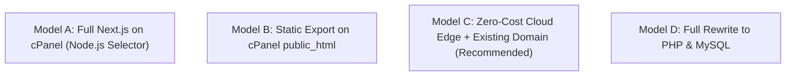

# WOwCars — cPanel Hosting Compatibility & Zero-Budget Deployment Analysis

**Document Version:** 2.0.0  
**Target Audience:** Founder & Technical Implementation Team  
**Business Context:** Existing registered domain name + existing shared cPanel hosting; ₹0 additional budget  

---

## 1. The Reality of Shared cPanel Hosting for Next.js

Shared cPanel hosting (provided by companies like GoDaddy, Hostinger, Bluehost, Namecheap, BigRock) is primarily optimized for **PHP and MySQL running behind Apache or LiteSpeed**. 

Deploying a modern full-stack Next.js application (Node.js 20+, React 19, Turbopack) onto shared cPanel introduces specific constraints that every technical leader must understand:

1. **Node.js Selector Limitations:**
   - Some shared hosting plans have the CloudLinux "Setup Node.js App" tool (Phusion Passenger). Many cheaper plans do **not** have it installed at all.
   - Where present, the maximum supported Node.js version is often 16.x or 18.x. **Next.js 16 requires Node.js 20.9.0 or higher.** Running an older Node version will cause startup crashes.
2. **RAM & Inode Quotas:**
   - Shared hosting enforces strict RAM limits per account (typically 512 MB to 1,024 MB). A running Node.js process together with MySQL can easily exceed this limit, triggering CloudLinux out-of-memory kills (Error 500 / 503 Service Unavailable).
   - Attempting to run `npm run build` or `npm install` on shared cPanel will almost certainly crash the server due to memory exhaustion.
3. **Apache / LiteSpeed Reverse Proxy:**
   - Node.js apps on cPanel run via Passenger or an internal port proxy. WebSocket support and streaming Server-Sent Events (SSE) often drop connections on shared setups.

However, **there are two completely viable, 100% free deployment pathways** that require zero extra spending and preserve the founder's existing domain and hosting.

---

## 2. Evaluation of the 4 Deployment Models

### Model A: Full Next.js Deployment on cPanel (Node.js Runtime)

- **How it Works:** Build the app locally on a computer using `npm run build` (with `output: "standalone"` enabled), upload the `.next/standalone` folder to cPanel, and configure cPanel's "Setup Node.js App" to execute `server.js`.
- **Compatibility Requirements:**
  - cPanel must have **"Setup Node.js App"** available.
  - Node.js version **20.x or higher** must be selectable.
  - Account RAM limit must be at least **1,024 MB (1 GB)**.
- **What Works:**
  - All current pages (`/`, `/cars`, `/cars/[code]`, `/dealers`, `/sell`).
  - Next.js dynamic routing, image optimization, and server-side rendering.
- **What Won't Work without Extra Services:**
  - Database persistence still requires connecting to MySQL or PostgreSQL.
- **Security Implications:**
  - If server memory is exceeded, the entire site goes down (503 Service Unavailable).
- **Deployment Complexity:** **High.** (Requires uploading via FTP/File Manager, setting environment variables, and configuring Passenger startup files).
- **Costs:** **₹0 mandatory cost** (uses existing hosting).

---

### Model B: Static Frontend Export on Shared cPanel (`public_html`)

- **How it Works:** Next.js compiles the entire frontend into static HTML, CSS, JavaScript, and media (`out/` folder). These static files are uploaded directly to the cPanel `public_html/` folder. Apache/LiteSpeed serves them just like traditional web pages.
- **Compatibility Requirements:**
  - Works on **100% of cPanel hosting plans** worldwide (no Node.js required, no RAM limits, no special server configuration).
- **What Works:**
  - All existing pages: Homepage with moving car video, vehicle search & filters, car detail pages, EMI calculator, dealer directory, and WhatsApp inquiry links.
  - 100% lightning-fast loading speeds on Apache/LiteSpeed with zero risk of memory crashes.
- **What Won't Work without Extra Services:**
  - Server Actions or dynamic server-side rendering (SSR) at runtime.
  - Any server-side form persistence must be handled by a lightweight backend script (e.g., a simple 50-line PHP script on cPanel that writes to cPanel MySQL).
- **Security Implications:**
  - Ultra-secure frontend. No Node.js process to crash or exploit.
- **Deployment Complexity:** **Low.** (Build locally, upload `out/` folder to `public_html` via cPanel File Manager).
- **Costs:** **₹0 mandatory cost**.

---

### Model C: Zero-Cost Cloud Edge + Existing Domain (Architect's Recommendation)

- **How it Works:**
  - Host the Next.js web application on **Vercel or Cloudflare Pages** (100% free hobby tier, unlimited bandwidth, global edge CDN).
  - Keep the founder's existing registered domain (e.g., `wowcars.in`). Simply point two DNS records (A Record / CNAME) to Vercel/Cloudflare.
  - Keep the existing cPanel hosting for business email (`concierge@wowcars.in`) and file backups.
  - Connect a free serverless database (Supabase or Neon PostgreSQL free tier, 0.5 GB, holds 25,000+ car listings).
- **Compatibility Requirements:**
  - Any domain registrar with DNS management access.
  - GitHub account to connect repository.
- **What Works:**
  - 100% of all Next.js features, instant automatic deployment on git push, free global SSL, automatic image optimization, and zero risk of cPanel server crashes.
- **Security Implications:**
  - Industry-standard enterprise security, automatic DDoS mitigation, zero server maintenance.
- **Deployment Complexity:** **Very Low.** (Connect GitHub repo, click Deploy, update 2 DNS records).
- **Costs:** **₹0 mandatory cost forever.**

---

### Model D: Full Rewrite to PHP & MySQL/MariaDB

- **How it Works:** Discard the Next.js codebase and rewrite the entire marketplace from scratch in PHP (Laravel or vanilla PHP) and MySQL to run natively on shared cPanel.
- **CTO Assessment:** **STRONGLY DISCOURAGED.**
  - **Why:** The founder has already invested time and effort into a modern React 19 / Next.js frontend with animations, tachometer HUD, video playback watchdog, and responsive UI. Rewriting everything in PHP would take 4–6 weeks of engineering effort, introduce countless new bugs, and provide a significantly inferior user experience.
  - **Verdict:** Unnecessary waste of time and budget.

---

## 3. Comparative Decision Matrix

| Dimension | Model A (Node.js on cPanel) | Model B (Static cPanel + PHP API) | Model C (Edge Cloud + Existing Domain) | Model D (PHP Rewrite) |
| :--- | :--- | :--- | :--- | :--- |
| **Budget Required** | **₹0** | **₹0** | **₹0** | High (Weeks of rework) |
| **cPanel Compatibility** | ~40% (Depends on host) | **100% (Guaranteed)** | **100% (Uses DNS only)** | 100% |
| **Risk of Server Crash** | High (RAM limit leaks) | Zero (Static files) | Zero (Global serverless) | Low |
| **Maintenance Burden** | High (Manual uploads) | Medium | Very Low (Auto CI/CD) | High |
| **Time to Launch** | 2–3 Days | 1–2 Days | **Same Day (30 Minutes)** | 4–6 Weeks |
| **CTO Recommendation** | Fallback if DNS locked | Strong Fallback | 🏆 **PRIMARY RECOMMENDATION** | ❌ Strongly Rejected |

---

## 4. Exact Step-by-Step Instructions for the Non-Technical Founder

To determine whether **Model A** (Node.js on your cPanel) is possible on your specific hosting package, follow these exact steps:

### Step 1: Check for Node.js Support in cPanel
1. Open your web browser and log in to your hosting account (e.g., GoDaddy, Hostinger, Bluehost, Namecheap).
2. Click **Go to cPanel** or open the **cPanel Dashboard**.
3. In the search bar at the very top of cPanel, type: `Node`
4. **Look at the search results:**
   - **Case 1:** You see an icon named **"Setup Node.js App"** or **"Node.js Selector"**.
     👉 *Your hosting supports Node.js! Click it and check the "Node.js version" dropdown. Note down the highest version number available (e.g., 18.x, 20.x, 22.x).*
   - **Case 2:** No results appear, or the icon is absent.
     👉 *Your shared hosting does NOT support Node.js. Proceed directly to Model B (Static Export) or Model C (Cloud Edge).*

### Step 2: Check RAM & Resource Limits
1. On the right-hand sidebar of your cPanel home screen, look at the **Statistics** panel.
2. Find the row labeled **Memory Usage** or **Physical Memory**.
3. Note the limit (e.g., `512 MB`, `1,024 MB / 1 GB`, or `2,048 MB / 2 GB`).
   - If the limit is **512 MB**, running Node.js in production is risky.
   - If the limit is **1 GB or higher**, Model A can run safely.

### Step 3: Check MySQL Database Availability
1. In cPanel search, type: `MySQL`
2. You will see **"MySQL Databases"** and **"phpMyAdmin"**.
3. This confirms you have 100% free access to unlimited relational database storage on your hosting.

### Step 4: Check Free SSL Status
1. In cPanel search, type: `SSL`
2. Click **SSL/TLS Status**.
3. Look for the green padlock next to your domain (`wowcars.in`). If it is not green, click the blue button **Run AutoSSL** to get your free Let's Encrypt SSL certificate activated.
