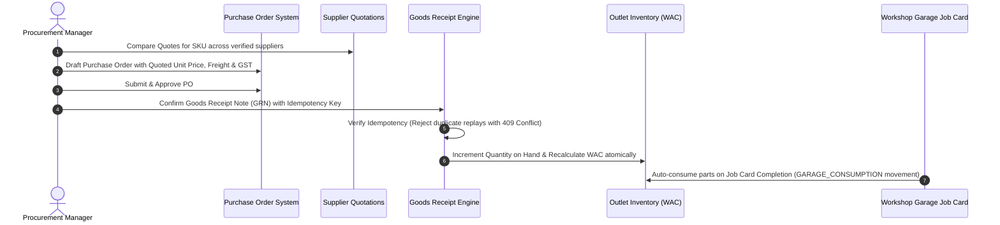

# WowCars — Automotive Operations, Garage, Auto Store, Procurement & Profitability Module

## Executive Overview
This document outlines the architecture, business logic, accounting rules, and operational manual for the **Automotive Operations & Workshop Management System** integrated into the existing WowCars platform.

Designed for an Indian automotive aftermarket business, the system manages:
1. **Used-Car Transaction Economics** (Owned Inventory vs. Consignment Brokerage Accounting).
2. **Multi-Brand Workshop & Garage Services** (PMS, mechanical, two-wheeler & car job cards with inspection checklists and parts consumption).
3. **Auto Store & Spares Inventory** (Weighted Average Cost valuation, bin-level tracking, reorder thresholds, and cross-outlet movements).
4. **Procurement & Supplier Management** (Verified vendor directory, multi-supplier quotation comparison, landed cost purchase orders, and duplicate-proof GRN receipts).
5. **Multi-Outlet Network Readiness** (Company-owned hub vs. 5% franchise operations with gated self-onboarding).
6. **Financial Reporting & Margin Analysis** (Gross Margin = Net Revenue − COGS, Operating Profit = Gross Profit − Opex, Provisional Cost Alerting, and Interactive ₹5L/₹7.5L/₹10L Scenario Planning).

---

## 1. Accounting Principles & Revenue Recognition Invariants

### 1.1 Gross Profit & Margin Formulas
* **Gross Profit (INR)** = Net Sales Revenue (excluding applicable taxes) − Cost of Goods Sold (COGS).
* **Gross Margin (%)** = `(Gross Profit ÷ Net Sales Revenue) × 100`.
* **Operating Profit (INR)** = Gross Profit − Recorded Operating Expenses (Rent, Salaries, Utilities, Marketing, Hoist Maintenance).
* **Operating Margin (%)** = `(Operating Profit ÷ Net Sales Revenue) × 100`.
* **Break-Even Revenue (INR)** = `Monthly Fixed Operating Expenses ÷ (Blended Gross Margin % ÷ 100)`.

### 1.2 Used-Car Revenue Recognition Barrier
To prevent artificial inflation of top-line company turnover:
* **Company-Owned Inventory (`OWNED_INVENTORY`)**: Full sale price recognized as gross top-line revenue. Direct vehicle acquisition cost, transport, advertising, inspection, and refurbishment are recognized as direct COGS.
* **Consignment Brokerage (`CONSIGNMENT_BROKERAGE`)**: The vehicle remains the property of the seller. **Only the brokerage commission fee (e.g., 2.5% or flat fee) is recognized as top-line revenue**. The gross vehicle sale price is excluded from company turnover, adhering strictly to Indian accounting and GST compliance.

### 1.3 Provisional Cost Alerting
* Any SKU or garage part consumed with an unverified or ₹0 recorded purchase cost is flagged with `isProvisionalCost: true`.
* Financial reports and job card cards display a amber warning badge: `⚠️ Provisional Cost — Margin Subject to Final Supplier Invoice`.
* Prevents presenting phantom margins as real business profits.

### 1.4 Consolidating Transfers
* Stock transfers between outlets (`outlet-blr-01` to `outlet-mys-01`) are recorded as inventory rebalances at current Weighted Average Cost (WAC). Internal dispatches are strictly excluded from consolidated sales revenue to prevent double-counting.

---

## 2. Procurement & Inventory Workflow



### 2.1 Weighted Average Cost (WAC) Recalculation Formula
Upon confirmed goods receipt note (GRN):
$$\text{New WAC} = \frac{(\text{Existing Quantity} \times \text{Current WAC}) + (\text{Accepted Quantity} \times \text{Unit Landed Cost})}{\text{Existing Quantity} + \text{Accepted Quantity}}$$

### 2.2 Goods Receipt Idempotency
Every GRN submission requires an `idempotencyKey` (e.g., `grn-idem-{poId}-{timestamp}`). Subsequent requests with the identical idempotency key are rejected with `HTTP 409 Conflict`, completely preventing accidental double-inventory incrementation.

---

## 3. Role-Based Access Control (RBAC) Matrix

| Module / Action | Super Admin | Admin | Operations | Procurement Mgr | Outlet Mgr | Technician | Franchise User | Public / Dealer |
| :--- | :---: | :---: | :---: | :---: | :---: | :---: | :---: | :---: |
| **Operations Overview** | Full | Full | Full | Read | Assigned Outlet | No | Assigned Outlet | Denied |
| **Financial P&L & CSV** | Full | Full | Full | No | Assigned Outlet | Denied (403) | Royalty only | Denied |
| **Suppliers & Quotes** | Full | Full | Full | Full | Read | No | Read Quotes | Denied |
| **Purchase Orders & GRN** | Full | Full | Full | Full | Outlet Limits | No | Request only | Denied |
| **Inventory & Transfers** | Full | Full | Full | Full | Outlet Full | Read Only | Outlet Stock | Denied |
| **Garage Job Cards** | Full | Full | Full | Full | Full | Assigned Jobs | Outlet Jobs | Denied |
| **Used Car Economics** | Full | Full | Full | Read | Assigned Outlet | No | Denied | Denied |
| **Franchise Gating** | Full | Full | Read | Read | No | No | No | Denied |

---

## 4. Multi-Outlet Network Configuration

* **Koramangala Pilot Hub (`outlet-blr-01`)**: Company-owned combined flagship workshop, retail parts store, and used-car certification bay.
* **Mysuru Express Garage (`outlet-mys-01`)**: Franchise outlet operated by Chamundi Auto Ventures LLP.
  * Contractual terms: 5.0% royalty on garage labour & retail sales.
  * Initial franchise self-onboarding gate: Set to `false` (requires explicit Super Admin activation).
  * Central procurement limits: Hard-capped at ₹5,00,000 to prevent unauthorized liabilities.

---

## 5. Automated Test Verification Results

The automated test script `scripts/test-garage-operations.ts` executes 10 comprehensive end-to-end integration tests:

1. **Role and Outlet Access Control**: Verified 401 for anonymous access, 403 for technician access to private financials, and 200 for Super Admin.
2. **Supplier Management & Quotation Ranking**: Verified 5 vendor profiles and automatic ranking of quotations by unit price ascending for SKU `BOSCH-OF-019`.
3. **Purchase Order Landed Cost Computation**: Drafted and approved PO with base cost, 18% GST, and freight charges.
4. **Goods Receipt Note (GRN) Idempotency**: Verified atomic stock and WAC update; verified duplicate submission with identical idempotency key returns HTTP 409 Conflict.
5. **Inter-Outlet Stock Transfer**: Dispatched 5 units from Koramangala Hub to Mysuru outlet, confirmed receipt without double-counting revenue.
6. **Garage Job Card & Provisional Cost**: Verified PMS job card with inspection checklist, labor calculation, and automatic detection of provisional costs.
7. **Job Completion & Stock Decrement**: Verified that transitioning job status to `COMPLETED` automatically deducts consumed parts from outlet inventory.
8. **Used-Car Economics (Owned vs. Consignment)**: Verified full vehicle sale price turnover for owned vehicle (₹7.45L) vs. fee-only recognition (₹28,000) for consignment.
9. **Scenario Planning Calculator**: Verified ₹5L, ₹7.5L, and ₹10L investment presets and verified division-by-zero protection in break-even formula.
10. **Financial Reporting & CSV Export**: Verified P&L summary breakdown, actual-versus-budget variance, 5% franchise terms, and validated `text/csv` export stream.

All 10 tests passed with 0 failures:
```
==================================================================================
   TEST RESULTS: 10 PASSED, 0 FAILED                    
==================================================================================
```
