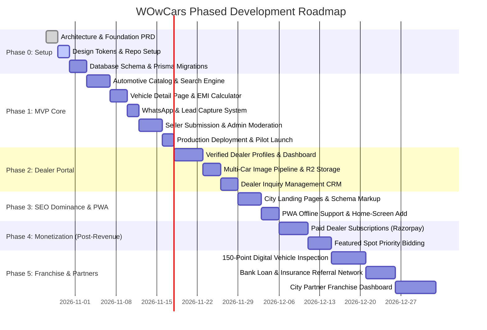

# WOwCars — Implementation Roadmap & Execution Plan

**Document Version:** 1.0.0  
**Methodology:** Incremental Agile, Zero-Waste Delivery, Production-Verified Releases  
**Current Phase:** Foundation & Architecture (Phase 0)  

---

## 1. Roadmap Overview & Strategic Horizon

---

## 2. Detailed Phase Specifications

### Phase 0: Foundations & Design System (Sprint 1)
- **Objective:** Establish a clean, maintainable repository, configure the design system matching the WOwCars brand (Crimson Red `#E50914`, Charcoal `#121212`, Crisp White), set up database migrations, and establish code quality gates.
- **Dependencies:** None.
- **Deliverables:**
  1. Next.js 14+ / React 18+ repository structure with TypeScript.
  2. Handcrafted Vanilla CSS design system with CSS tokens in `src/styles/globals.css`.
  3. Reusable UI primitives: `Button`, `Badge`, `Card`, `Input`, `Select`, `Modal`, `Navbar`, `Footer`.
  4. Prisma schema initialized with PostgreSQL / MySQL connection.
- **Acceptance Criteria:**
  - Responsive layout verified across mobile (375px), tablet (768px), and desktop (1280px+).
  - Design tokens render exact brand colors from the official logo.
  - Zero linter errors and type-check passing (`npm run lint`, `npm run build`).

---

### Phase 1: MVP Core Marketplace (Sprint 2 - 3) — ZERO OPERATIONAL COST
- **Objective:** Enable car buyers to discover verified cars in Bengaluru, view detailed specifications, calculate EMIs, connect with sellers via WhatsApp, and allow private sellers to list vehicles with admin approval.
- **Key Features:**
  1. **Automotive Catalog & Search Engine:**
     - Instant filtering by Budget (Price in Lakhs), Brand/Make, Fuel Type, Transmission, Body Type, Year, and City.
     - Responsive grid and card layout displaying key trust tags ("1st Owner", "Low KM", "Petrol", "Verified").
  2. **Vehicle Detail Page (VDP):**
     - Full-width image gallery with zoom modal.
     - Complete specs breakdown: Engine, Transmission, RTO Registration (e.g., KA-04, KA-50), Insurance Validity, Hypothecation Status.
     - Interactive Loan EMI Calculator (Loan Amount, Tenure, Rate slider).
  3. **Zero-Cost WhatsApp & Lead System:**
     - Direct `wa.me` WhatsApp deep-link with prefilled vehicle title, ID, price, and URL.
     - Contact Seller / Book Test Drive modal with spam honeypot and rate limiting.
  4. **Seller Listing Portal:**
     - Step-by-step submission form for individual sellers.
     - Client-side image compression to WebP.
     - Default status set to `PENDING_APPROVAL`.
  5. **Admin Moderation Desk:**
     - Password-protected admin view to approve, reject, or edit listings.
     - Audit logging for moderation actions.
- **Testing Requirements:**
  - Automated unit tests for EMI calculation logic and filter algorithms.
  - Integration tests for car creation, validation errors, and admin status updates.
  - Manual mobile walkthrough on Android & iPhone simulators.

---

### Phase 2: Verified Dealer Portal & R2 Storage (Sprint 4)
- **Objective:** Empower local used-car dealers in Bengaluru to create verified digital showrooms, showcase their lot, and manage customer inquiries.
- **Key Features:**
  1. **Dealer Onboarding & KYC:**
     - Registration with dealership name, location, contact, and GST/Trade License upload.
     - Admin verification badge ("WOwCars Verified Dealer").
  2. **Dedicated Dealer Showroom Pages:**
     - Clean URL: `wowcars.in/dealers/dealership-name`.
     - Displays showroom address, map pin, Google rating badge, and active inventory.
  3. **Cloudflare R2 Direct Uploads:**
     - Presigned upload URLs enabling dealers to upload 10–20 car photos in seconds.
     - Storage quota monitoring.
  4. **Dealer Lead Inbox:**
     - Basic dashboard showing all WhatsApp clicks and test drive inquiries per car.
- **Acceptance Criteria:**
  - Dealers can add a car in under 3 minutes from a mobile phone.
  - Images upload directly to R2 with zero disk usage on the web hosting server.

---

### Phase 3: SEO Dominance & PWA Installation (Sprint 5)
- **Objective:** Drive organic Google search traffic across Bengaluru localities and enable app-like mobile experience.
- **Key Features:**
  1. **City & Locality Landing Pages:**
     - SSR pages for `/used-cars-in-bangalore`, `/used-cars-in-yelahanka`, `/used-cars-in-whitefield`, `/used-cars-in-indiranagar`.
     - Model-specific city pages: `/used-hyundai-creta-in-bangalore`, `/used-maruti-swift-in-bangalore`.
  2. **Automotive JSON-LD Schema:**
     - Schema.org `Car` and `AutomotiveBusiness` structured data for rich Google search cards.
  3. **PWA (Progressive Web App):**
     - Web App Manifest with WOwCars red icon.
     - Service worker for offline asset caching.
     - "Add to Home Screen" prompt for mobile shoppers.

---

### Phase 4: Monetization & Paid Subscriptions (POST-REVENUE)
> [!IMPORTANT]
> **Strictly deferred until WOwCars achieves 100+ active listings and proven dealer engagement.**
- **Features:**
  1. **Dealer Subscription Plans:** Free Tier (up to 5 cars), Starter Tier (₹1,499/mo for 20 cars), Pro Tier (₹3,499/mo for 50 cars + 5 featured spots).
  2. **Payment Gateway Integration:** Indian payment gateway (Razorpay or Cashfree) supporting UPI, Credit Cards, Net Banking.
  3. **Featured Listing Placement:** Paid top-of-search promotion banner.
  4. **Revenue Accounting Dashboard:** Real-time MRR (Monthly Recurring Revenue) tracking.

---

### Phase 5: Value-Added Services & Franchise Network (EXPANSION)
> [!IMPORTANT]
> **Strictly deferred until the platform generates operating profits.**
- **Features:**
  1. **150-Point Digital Inspection Module:**
     - Tablet-optimized checklist for certified inspectors.
     - Auto-generated PDF inspection certificate with digital stamp.
  2. **Bank Loan & Insurance Referral Gateway:**
     - Integration with lending partners (HDFC, ICICI, IDFC FIRST) and insurance brokers.
     - Lead tracking and referral commission calculation.
  3. **City Partner & Franchise Portal:**
     - Multi-city hierarchy allowing regional partners (e.g., Mysuru, Hubballi, Pune) to manage local dealerships with territory revenue sharing.

---

## 3. Strict Deferral Matrix (What NOT to build today)

| Feature | Reason for Deferral | Trigger for Inclusion |
|---|---|---|
| **Paid WhatsApp Business Cloud API** | Meta charges per conversation; adds unnecessary fixed & variable cost. | Defer until dealer subscriptions fund operating expenses. |
| **SMS OTP Verification (DLT)** | High upfront regulatory cost (~₹5,900 DLT registration) + recurring SMS fees. | Defer until paid dealer logins or anti-fraud requirements demand it. |
| **Native iOS / Android App Stores** | Apple Developer ($99/yr) + Google Play ($25) + dual maintenance. PWA provides 90% of native experience for ₹0. | Defer until monthly revenue exceeds ₹50,000. |
| **Paid AI APIs / Car Photo Enhancers** | Expensive API subscriptions (e.g., Remove.bg at $0.20/image). | Defer until dealers request and pay for premium listing add-ons. |
| **Microservices / Kubernetes** | High infrastructure cost, massive engineering overhead. A single modular Next.js app easily handles 100,000 monthly visitors. | Defer until database exceeds 500,000 rows. |
| **Live Chat / Call Center IVR** | Staffing and telephony costs (Exotel/Knowlarity). Direct WhatsApp is preferred by Indian consumers. | Defer until city partners manage dedicated phone support. |
