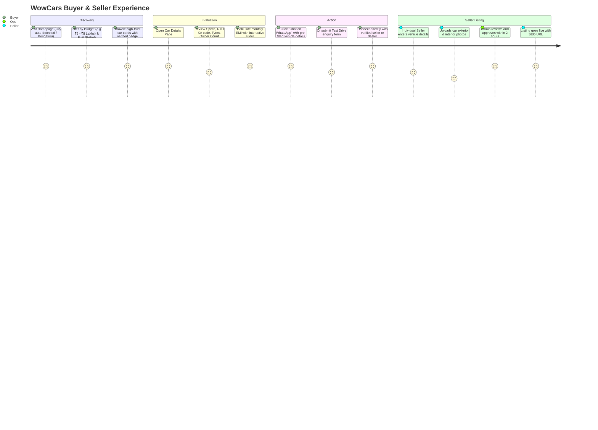

# WowCars — Product Requirements Document (PRD)

**Document Version:** 1.0.0  
**Status:** Approved for Implementation  
**Product:** WowCars — Pre-Owned Cars You Can Trust  
**Primary Pilot Market:** Bengaluru (Bengaluru Urban & Rural - 64 / Yelahanka / Greater Bengaluru) & Pan-India Expansion  
**Official Support Contact:** +91 901 908 8160  

---

## 1. Executive Summary & Vision

### 1.1 The Market Opportunity
The Indian pre-owned car market is expanding rapidly, projected to reach over 8 million vehicles annually. However, used car buyers and sellers in India face deep structural challenges:
- **Severe Trust Deficit:** Fear of odometer tampering, hidden accidental history, flood-damaged cars, pending hypothecation/traffic challans, and fake documentation.
- **Aggressive Middlemen & High Commissions:** Aggregators and brokers charge exorbitant commissions (up to 5%–10% of vehicle value) or push lowball distress-sale offers on private sellers.
- **Classifieds Spam & Privacy Violations:** Traditional open classifieds (like OLX) result in phone numbers being leaked, spam calls, fraudulent buyers, and dangerous meetup requests.
- **Fragmented Independent Dealers:** Thousands of independent, honest local used car dealerships lack an affordable digital storefront to showcase verified inventory without paying high monthly aggregator fees.

### 1.2 The WowCars Mission
**WowCars** ("*Pre-Owned Cars You Can Trust*") bridges this gap by creating an affordable, transparent, and verified marketplace. It empowers:
1. **Buyers** to discover verified pre-owned cars with transparent pricing, comprehensive specifications, condition disclosures, and instant WhatsApp communication.
2. **Individual Sellers** to list personal cars safely with phone privacy protection, realistic market pricing guidance, and direct buyer inquiries.
3. **Verified Local Dealers** to establish a branded digital showroom, manage inventory, and capture high-intent local leads at zero or low predictable subscription costs.
4. **City Partners & Franchisees** to expand the WowCars trust network across Tier-1, Tier-2, and Tier-3 cities in India through standardized physical inspections and dealership onboarding.

### 1.3 Core Brand Identity & Palette
- **Brand Name:** WowCars
- **Brand Slogan:** Pre-Owned Cars You Can Trust
- **Color Identity:**
  - **WowCars Crimson Red:** `#E50914` (Energy, speed, passion, attention)
  - **Deep Carbon / Charcoal:** `#121212` and `#1E1E1E` (Premium automotive feel, authority)
  - **Crisp Neutral White:** `#FFFFFF` (Clarity, honesty, readability)
  - **Automotive Silver / Slate:** `#8E8E93` and `#2C2C2E` (Borders, structural elements)
  - **Trust Green:** `#10B981` (Verified badge, WhatsApp action, inspected status)

---

## 2. Target Personas & Use Cases

### Persona 1: The Cautious Indian Buyer ("Rahul Sharma", 32, Software Professional, Bengaluru)
- **Profile:** First-time car buyer or upgrading from a 2-wheeler/hatchback to a compact SUV (Creta, Nexon, Brezza). Budget: ₹5 to ₹10 Lakhs.
- **Pain Points:** Worried about buying an accidental or flooded car; overwhelmed by misleading dealer ads; dislikes pushy sales calls.
- **Needs:** Clear photos (exterior, interior, engine bay, tyres, odometer), verified registration/RTO details (e.g., KA-04, single owner), transparent price breakdown, EMI calculator, and the ability to ask questions directly via WhatsApp before travelling to inspect the car.

### Persona 2: The Private Car Seller ("Ananya Hegde", 38, HR Manager, Bengaluru)
- **Profile:** Wants to sell her 2018 Honda City (Single Owner, 42,000 km) to upgrade to an EV.
- **Pain Points:** Offered 30% below market value by instant-cash aggregators; terrified of receiving 50 unsolicited dealer calls at odd hours if posted on open classifieds.
- **Needs:** Clean, self-service listing flow; masking of personal phone number or controlled WhatsApp-first inquiries; clear fair-market valuation guidance; control over listing status once sold.

### Persona 3: The Standalone Pre-Owned Car Dealer ("Sri Balaji Motors", Yelahanka, Bengaluru)
- **Profile:** Independent dealer with 15–30 cars on his lot; relies on word-of-mouth and expensive aggregator subscriptions that keep increasing in price.
- **Pain Points:** Cannot afford ₹30,000–₹50,000/month fees charged by corporate aggregators; wants his own brand recognized rather than hidden behind an aggregator badge.
- **Needs:** Low-cost/Free digital showroom; easy inventory addition (takes less than 3 minutes per car from smartphone); direct qualified customer leads sent to his WhatsApp; branded dealer profile page.

### Persona 4: The WowCars City Partner / Franchisee ("Vikram Patel", Hubballi / Mysuru)
- **Profile:** Local automotive entrepreneur wanting to operate the WowCars franchise in a regional city.
- **Pain Points:** Hard to build a proprietary marketplace tech platform from scratch.
- **Needs:** Territory exclusivity; ability to onboard local dealers; physical inspection booking workflow; commission tracking on partner services (loans, insurance, inspections).

### Persona 5: Platform Administrator ("WowCars Operations & Trust Team")
- **Profile:** Managing the central marketplace, ensuring listing quality, preventing fraud, and supporting customers.
- **Needs:** Quick moderation dashboard to approve/reject listings; verify dealer KYC (GST/Trade License/PAN); monitor lead activities; resolve disputes.

---

## 3. Product Scope: MVP vs Future Phases

To ensure zero unnecessary cost and rapid launch, the product is strictly phased:

| Feature Area | Phase 1: MVP (Zero/Near-Zero Cost) | Phase 2: Dealer Growth | Phase 3: Monetization & Value-Add |
|---|---|---|---|
| **Inventory Browsing** | Search by Make, Model, City, Budget, Fuel, Transmission, KM | Saved searches, email alerts | AI-assisted vehicle recommendation |
| **Car Listing Detail** | Comprehensive specs, RTO info, high-res gallery, EMI widget, WhatsApp CTA | 360-degree interior viewer, video walkaround | Complete PDF inspection report download |
| **Buyer Contact** | Free direct WhatsApp click-to-chat (`wa.me`) + Lead Form | Dealer CRM lead status tracking | In-app masked calling / IVR |
| **Seller Portal** | Individual car submission form with admin approval queue | Edit/Mark Sold/Relist, view count stats | Instant AI image background cleaner |
| **Dealer Portal** | Basic verified dealer profile & inventory list | Dedicated Dealer Dashboard, multi-car manager | Bulk inventory feed / API import |
| **Vehicle Inspection** | Manual request form (Ops coordinates via phone) | Digital 150-point checklist for inspectors | Automated inspection report generation |
| **Car Loan & Insurance** | Static referral lead capture form sent to Ops team | Pre-approved bank partner integrations | Instant automated eligibility check |
| **Payments & Monetization** | 100% Free for buyers and early sellers/dealers | Dealer subscription packages (Razorpay/Cashfree) | Pay-per-lead / Featured top-spot bidding |

---

## 4. Detailed User Journeys

### 4.1 Car Buyer Journey
1. **Landing & Localization:** User visits `wowcars.in` (defaults to Bengaluru, can switch to Mumbai, Delhi NCR, Hyderabad, Chennai, Pune, etc.).
2. **Intuitive Search & Filtering:**
   - Budget slider in Indian Rupees (e.g., Under ₹3 Lakhs, ₹3–₹5 Lakhs, ₹5–₹8 Lakhs, ₹8–₹15 Lakhs, ₹15+ Lakhs).
   - Fuel Type: Petrol, Diesel, CNG, Electric, Hybrid.
   - Transmission: Manual, Automatic.
   - Body Type: Hatchback, Sedan, SUV, MUV, Luxury.
   - KM Driven, Year of Manufacture, Number of Owners (1st Owner, 2nd Owner, etc.).
3. **Vehicle Inspection on Screen:**
   - High-resolution photo gallery with zoom capability.
   - Key Trust Factors highlighted: RTO Location (e.g., KA-04 Yeshwanthpur, KA-50 Yelahanka), Insurance Validity, Hypothecation Status, Service Records availability.
   - Interactive EMI Calculator: Loan amount, tenure (1–7 years), interest rate (8.5%–14%).
4. **Zero-Friction Communication:**
   - Primary Action: **"Chat on WhatsApp"** button. Generates a pre-filled WhatsApp message containing the exact Car ID, Title, Price, and URL directly to the verified seller/dealer.
   - Secondary Action: **"Book Test Drive / Request Callback"** form. Notifies WowCars Ops and the dealer immediately.

### 4.2 Individual Seller Journey
1. **Click "Sell Your Car":** Prompted to enter car registration number or select Make, Model, Variant, Year.
2. **Condition Details:** Enter odometer reading (KM), fuel type, transmission, color, owner count, insurance status, asking price in ₹ Lakhs.
3. **Photo Upload:** Upload 5 to 15 photos (Front, Rear, Left, Right, Dashboard, Rear Seats, Odometer, Engine Bay, Tyres).
4. **Phone Verification & Privacy Selection:**
   - Seller enters mobile number.
   - Choose privacy setting: "Allow direct WhatsApp inquiries" or "Route all buyer inquiries through WowCars concierge".
5. **Submission & Verification:** Listing status changes to `Pending Approval`. WowCars Ops reviews for spam/misleading data and approves within 2 hours.

### 4.3 Verified Dealer Journey
1. **Dealer Registration:** Dealer enters business name, physical showroom address, contact person, WhatsApp number, and optional GST/trade license.
2. **KYC Verification:** Admin validates dealer identity and unlocks the Dealer Dashboard.
3. **Inventory Management:**
   - Quick Add: Upload cars with showroom branding.
   - Active, Sold, and Draft status toggles.
   - Track total views and WhatsApp inquiries per car.
4. **Branded Showroom Page:** Dedicated public URL (e.g., `wowcars.in/dealers/sri-balaji-motors-yelahanka`) showing all active cars from this dealer.

### 4.4 Administrator Journey
1. **Secure Admin Authentication:** Multi-factor protected administrator dashboard.
2. **Moderation Queue:**
   - Review pending car listings.
   - Inspect photos for watermarks of competing portals (OLX, Cars24, etc.).
   - Approve, Reject (with reason), or Request Edits.
3. **Dealer & Partner Verification:** Review submitted business documents, mark as "WowCars Verified Dealer".
4. **Lead Monitor:** View all test drive inquiries and partner loan/insurance leads with export capability (CSV).

---

## 5. Functional Requirements & Acceptance Criteria

### 5.1 Public Marketplace & Search
- **REQ-001 (Fast Search Engine):** Search results must filter within 150ms client-side or <300ms server response time.
- **REQ-002 (City-Specific Landing Pages):** System must provide clean, SEO-optimized URLs:
  - `/used-cars-in-bangalore`
  - `/used-cars/suv/bangalore`
  - `/used-cars/hyundai/creta/bangalore`
- **REQ-003 (Indian Number Formatting):** All vehicle prices must display formatted in Indian numbering system (e.g., `₹ 6,45,000` and `₹ 6.45 Lakhs`), never western millions.
- **REQ-004 (Empty State Handling):** If zero cars match a search filter, display related alternatives in the same city or allow the user to submit an alert request.

### 5.2 Car Detail Page (VDP)
- **REQ-005 (Media Gallery):** Responsive image carousel with thumbnail navigation, swipe gestures on mobile, and full-screen lightbox modal.
- **REQ-006 (Trust Card):** Visible badge showing Seller Type (Individual vs Verified Dealer), Inspection Rating (if inspected), and Verification status.
- **REQ-007 (WhatsApp Deep Linking):** WhatsApp button must generate RFC 3986 encoded URL:
  `https://wa.me/91XXXXXXXXXX?text=Hi%20WowCars%2C%20I%20am%20interested%20in%20the%202021%20Hyundai%20Creta%20SX%20(ID%3A%20WC-1049)%20listed%20for%20%E2%82%B912.50%20Lakhs.%20Is%20it%20available%3F`
- **REQ-008 (EMI Calculator):** Dynamic interactive sliders for Down Payment, Loan Tenure, and Interest Rate calculating monthly EMI using the standard reducing balance formula.

### 5.3 Listing Management & Moderation
- **REQ-009 (Image Optimization):** All user-uploaded images must be automatically resized, converted to modern WebP format, and compressed before permanent storage to eliminate wasted storage and slow page loads.
- **REQ-010 (Role-Based Permissions):**
  - Guests: View listings, search, submit inquiries.
  - Registered Sellers: Manage own cars only.
  - Verified Dealers: Manage dealership inventory and view incoming leads.
  - Administrators: Full CRUD on all listings, users, dealers, and site configurations.
- **REQ-011 (Audit Trail):** Any change in listing price, status (Pending -> Active -> Sold), or user role must record an immutable audit log entry.

### 5.4 Lead & Value-Added Services Capture
- **REQ-012 (Finance Referral Form):** Collect borrower name, phone, city, employment type (Salaried / Self-Employed), monthly income, and required loan amount.
- **REQ-013 (Insurance Form):** Collect car registration number, current insurer, expiry date, and claim history.
- **REQ-014 (Spam Prevention):** All public enquiry forms must incorporate honeypot fields and rate limiting (max 5 inquiries per IP per 10 minutes) to eliminate bots without degrading user experience.

---

## 6. Non-Functional Requirements

- **Performance:** First Contentful Paint (FCP) < 1.2s; Largest Contentful Paint (LCP) < 2.5s on 4G mobile connections.
- **Mobile First:** 85%+ of Indian used-car traffic originates on Android and iOS smartphones. Touch targets must be at least 44x44px; UI must look and feel like a native application.
- **PWA Readiness:** Manifest, service worker registration, and icons pre-configured to allow users to "Add to Home Screen" on Android without paying Google Play Store developer account fees.
- **Accessibility:** Semantic HTML5, ARIA labels on all modal and interactive elements, high contrast ratio (>4.5:1) for text readability.
- **Data Privacy:** Full adherence to India’s Digital Personal Data Protection Act (DPDPA 2023). User consent checkboxes for marketing or WhatsApp communication.

---

## 7. Success Metrics & Launch KPIs

1. **Inventory Target (First 60 Days):** 100+ high-quality verified cars listed in Bengaluru.
2. **Dealer Network:** 15+ trusted independent used-car dealers onboarded in Bengaluru North / Yelahanka / Central.
3. **Engagement:** >40% of car detail page visitors clicking "Chat on WhatsApp" or submitting an inquiry.
4. **Zero Hosting Cost Overrun:** Ensuring ₹0 infrastructure cost beyond existing domain/hosting during the initial pilot phase.
