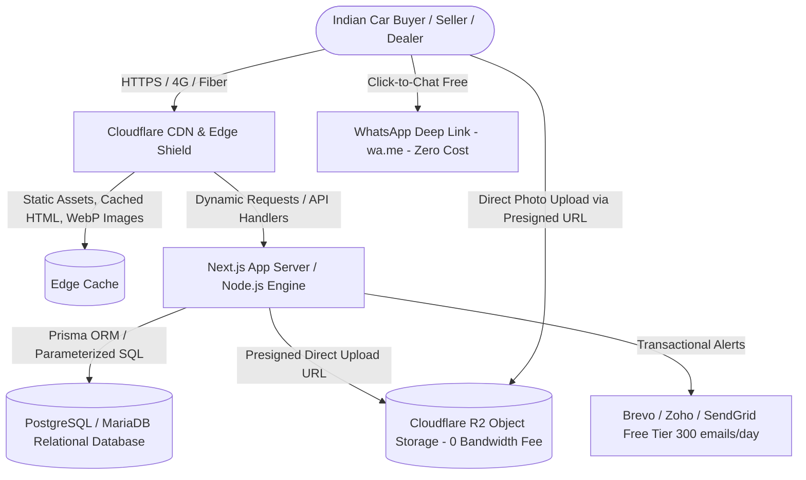
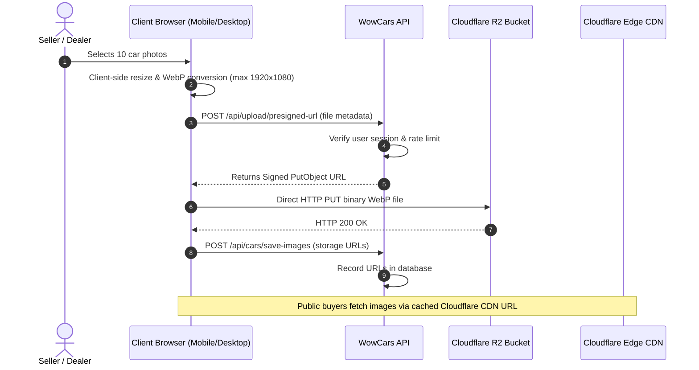

# WowCars — Technical Architecture & Infrastructure Blueprint

**Document Version:** 1.0.0  
**Target Platform:** Mobile-First Web Application (PWA Ready)  
**Primary Domain & Hosting Context:** Existing Domain & Hosting Owned; ₹0 Budget for New Recurring Subscriptions  
**Operating Location:** Bengaluru, India (+91 901 908 8160)  

---

## 1. Architectural Philosophy & Strategy

To realize the founder's vision of building a Pan-India trusted car marketplace with **no additional investment available**, the technical architecture is governed by four core tenets:

1. **Zero-Waste Hosting Utilization:** Maximize the existing web hosting and free tiers of battle-tested enterprise platforms (Cloudflare, Supabase / Neon, GitHub Actions) to run at **₹0 added operational cost**.
2. **Offload Disk & Bandwidth (Image Storage):** Car marketplaces are notoriously image-heavy (10 to 20 photos per car). Storing high-res images on traditional shared web hosting quickly exhausts disk quotas (causing site takedown) and consumes all monthly bandwidth. We decouple images using zero-egress object storage (Cloudflare R2 or Cloudinary).
3. **SEO-First Rendering for City Dominance:** Used car buyers search Google for *"used creta in bangalore"*, *"second hand automatic cars yelahanka"*. The frontend architecture provides Server-Side Rendering (SSR) and Static Site Generation (SSG) with structured JSON-LD schemas so pages rank organically without paying for Google Ads.
4. **Decoupled, Modular Codebase:** Avoid monolithic lock-in. The frontend UI, API routes, and relational database layer are cleanly separated so that if the founder migrates hosting providers in the future, the migration takes hours, not months.

---

## 2. Recommended Technology Stack



### 2.1 Technology Selection Breakdown

| Layer | Recommended Technology | Why Selected & Cost Justification |
|---|---|---|
| **Frontend Framework** | **Next.js (React 18/19, App Router, TypeScript)** | Industry standard for automotive portals. Provides hybrid rendering: static generation for car models & city landing pages (instant load, perfect SEO) + dynamic server rendering for active inventory and admin dashboards. PWA ready. |
| **Styling & Design System** | **Modern Vanilla CSS & CSS Modules** | Zero runtime overhead, maximum performance on budget Indian Android smartphones (Jio, Redmi, Vivo). Handcrafted design tokens matching WowCars brand (Crimson Red `#E50914`, Carbon Black `#121212`, Crisp White). Avoids bloated CSS libraries. |
| **Backend / API Layer** | **Next.js Route Handlers / Node.js** | Unifies frontend and backend in a single maintainable repository. TypeScript ensures end-to-end type safety from database models to UI components. Runs seamlessly on Node.js-compatible hosting or serverless containers. |
| **Data Validation** | **Zod** | Runtime schema validation for every API request, search query, and form input. Prevents bad data injection before it touches the database. |
| **Database & ORM** | **PostgreSQL + Prisma ORM** (or MySQL on shared hosting) | Relational integrity is mandatory for financial amounts, vehicle status, dealer verification, and audit logs. Prisma provides type-safe migrations and parameterized queries to prevent SQL injection. |
| **Image Storage & CDN** | **Cloudflare R2 Storage** (or Cloudinary Free Tier) | **Cloudflare R2 offers 10 GB storage free with ₹0 egress bandwidth fees forever.** Competitors (like AWS S3) charge for egress bandwidth, which would bankrupt a bootstrapped marketplace once traffic grows. |
| **Authentication & RBAC** | **JWT / Secure Cookie Session Auth** with **Argon2id/bcrypt** | Fully self-hosted, eliminating expensive auth services like Auth0 ($300+/month). Implements Role-Based Access Control (Buyer, Seller, Dealer, City Partner, Admin). |
| **Communications** | **Direct WhatsApp Deep Linking (`wa.me`) + Free SMTP** | ₹0 cost. WhatsApp Business Cloud API requires meta verification and per-conversation fees (₹0.70 to ₹2.50 per conversation). `wa.me` links cost ₹0 and launch native WhatsApp directly. |

---

## 3. Hosting Evaluation & Deployment Topology

### 3.1 Existing Hosting Analysis
The founder has an existing domain and web hosting package. Here is how we accommodate different possible hosting types without forcing paid upgrades:

#### Scenario A: Existing Hosting is cPanel / Linux Shared Hosting (Hostinger, GoDaddy, Bluehost, Namecheap)
- **Capabilities:** Typically provides Apache/Nginx, PHP 8.x, MySQL/MariaDB, and often a **"Setup Node.js App"** (CloudLinux Passenger) interface.
- **Deployment Strategy:**
  1. We build the Next.js application as a standalone Node.js production server, deployed via cPanel Node.js App selector.
  2. The MySQL/MariaDB database included in the hosting package is used for data storage (or connected to an external cloud Postgres instance).
  3. All car photos are routed directly to Cloudflare R2, ensuring the shared hosting disk (often 10GB–30GB) is never exhausted.
- **Cost:** **₹0 additional.**

#### Scenario B: Existing Hosting is a VPS / Cloud Server (Linux Ubuntu)
- **Capabilities:** Full root access, Docker or systemd Node.js service, Nginx reverse proxy, free Let's Encrypt SSL.
- **Deployment Strategy:**
  1. Node.js 20 LTS managed via PM2 (process manager) with auto-restart.
  2. Local PostgreSQL 16 database with automated daily pg_dump backups to R2.
  3. Nginx reverse proxy with Gzip/Brotli compression and rate limiting.
- **Cost:** **₹0 additional** (runs within existing server resources).

#### Scenario C: Existing Hosting is Static or Outdated / Migration Path
- If the existing hosting is locked or fails to support Node.js:
  1. Deploy the Next.js frontend and API on **Cloudflare Pages / Vercel Hobby Tier** (100% Free).
  2. Use **Neon Serverless PostgreSQL** (Free 0.5GB tier, more than enough for 25,000 car listings) or **Supabase** (Free 500MB DB).
  3. Point the existing domain's DNS records (A/CNAME) to the free modern platform.
- **Cost:** **₹0 additional.**

---

## 4. Image Pipeline & Decoupled Media Storage



### Why this design is critical for a zero-budget founder:
1. **Zero Server Load:** Images are uploaded directly from the seller's browser to Cloudflare R2 using short-lived signed URLs. The main web hosting server never processes large file streams, preventing memory crashes.
2. **Client-Side Compression:** Images are converted to compressed `.webp` format in the user's browser before upload. A 10 MB smartphone photo shrinks to ~350 KB without perceptible quality loss.
3. **Zero Bandwidth Fees:** Cloudflare R2 does not charge any egress (download) fees. 50,000 car buyers viewing 10 photos each = 500,000 photo views = **₹0 data transfer cost**.

---

## 5. Communications Architecture: WhatsApp, SMS & Email

### 5.1 WhatsApp Strategy (The Lifeblood of Indian Automotive Commerce)
- **The Problem:** The official Meta WhatsApp Business Cloud API charges per conversation (Service: ~₹0.35, Utility: ~₹0.40, Marketing: ~₹0.80 + GST per conversation), plus setup costs and green tick application fees.
- **The Bootstrapped Solution (Zero Cost):**
  We utilize standardized, intelligent URL schemes using the official `https://wa.me/` protocol:
  ```
  https://wa.me/919019088160?text=Hello%20WowCars!%20I%20am%20interested%20in%20the%202021%20Hyundai%20Creta%20SX%20(ID:%20WC-892)%20priced%20at%20%E2%82%B912.45%20Lakhs.%20Is%20it%20available%20for%20test%20drive%3F%20Listing:%20https://wowcars.in/cars/hyundai-creta-sx-892
  ```
- **Benefits:**
  - Zero API subscription fees.
  - Zero per-message charges.
  - Opens directly inside the buyer's native WhatsApp app with the vehicle info pre-filled.
  - Direct connection to WowCars concierge or the verified dealer.

### 5.2 SMS & DLT Regulations
- In India, commercial SMS requires Telecom Regulatory Authority of India (TRAI) **DLT (Distributed Ledger Technology) registration**, entity verification fees (~₹5,900 one-time), SMS header approval, and template approvals on portals like Vilpower/Jio/Airtel.
- **Decision:** SMS OTP is **strictly excluded for the MVP**. We use secure Email Magic Links and Email Verification (which are completely free) to avoid upfront regulatory fees and recurring SMS costs.

### 5.3 Transactional Email
- **Service:** Brevo (formerly Sendinblue) or Zoho Mail or SendGrid.
- **Free Tier:** 300 transactional emails/day free forever.
- **Usage:** Welcome emails, listing approval notices, password resets, and new lead alerts to dealers.

---

## 6. Progressive Web App (PWA) & Mobile Strategy

Over 85% of car shoppers in India browse on mobile devices. Instead of spending money on Apple Developer ($99/year ≈ ₹8,300/year) and Google Play Developer ($25 one-time) licenses, we engineer the web application as a **Progressive Web App (PWA)**:
1. **Web App Manifest (`manifest.json`):** Defines brand name ("WowCars"), crimson theme color (`#E50914`), standalone display mode, and high-resolution icons.
2. **Service Worker:** Caches core UI layout, fonts, and styles for lightning-fast subsequent visits, even on erratic 4G/3G connections.
3. **Add to Home Screen:** Android users receive a native-like banner prompting them to install WowCars directly on their home screen without an app store download.
4. **Future Native App Path:** The same responsive React codebase and REST APIs can later be wrapped in **Capacitor** or transitioned to **React Native** once the business generates cash flow.

---

## 7. Cost Analysis & Financial Projections (INR)

### 7.1 Initial Launch / MVP Stage (0 to 1,000 Listings, 20,000 Monthly Visitors)

| Component | Provider / Service | Confirmed Price (INR) | Notes |
|---|---|---|---|
| **Domain Name** | Existing (`wowcars.in` or similar) | **₹0** (Already owned) | Annual renewal later ~₹800–₹1,000/year |
| **Primary Web Hosting** | Existing Hosting Package | **₹0** (Already owned) | Utilizing current cPanel / VPS |
| **Relational Database** | Included MySQL / Neon Postgres Free | **₹0** | Free tier holds up to 25,000 listings |
| **SSL / HTTPS Certificate** | Cloudflare / Let's Encrypt | **₹0** (Included free) | Automatic 90-day renewal |
| **CDN & DDoS Shield** | Cloudflare Free Plan | **₹0** | Unlimited bandwidth, global caching |
| **Car Image Storage** | Cloudflare R2 (10 GB free) | **₹0** | Holds ~25,000 compressed WebP car photos |
| **Image Egress / Bandwidth** | Cloudflare R2 | **₹0** | Zero egress fees |
| **Buyer-Seller Communication** | WhatsApp Deep Links (`wa.me`) | **₹0** | No API charges |
| **Transactional Email** | Brevo Free Tier (300 emails/day) | **₹0** | Covers 9,000 emails/month |
| **Total Monthly Running Cost** | | **₹0 / month** | **100% within existing resources** |

### 7.2 Post-Monetization Stage (Scale: 5,000+ Listings, 150,000 Monthly Visitors)
*Note: These are future estimates that will only be activated once the platform earns revenue from dealer subscriptions.*

| Component | Estimated Provider | Estimated Monthly Cost (INR) | Trigger for Upgrade |
|---|---|---|---|
| **Dedicated Cloud VPS** | Hetzner / Hostinger Cloud / DigitalOcean | ₹800 – ₹1,500 / month | When server RAM exceeds 80% on shared hosting |
| **Object Storage Expansion** | Cloudflare R2 (>10 GB) | ₹12 per 10 GB extra | At 50,000+ photos (~₹60/month) |
| **Transactional SMS / OTP** | Fast2SMS / MSG91 (DLT approved) | ₹0.18 – ₹0.25 per SMS | When paid dealer logins require SMS 2FA |
| **WhatsApp Business API** | Meta Cloud API via Wati/AiSensy | ₹1,500 – ₹2,500 / month | Automated lead qualification bots |

---

## 8. Backup, Monitoring & Disaster Recovery

1. **Automated Database Dumps:** Nightly cron job exports a compressed database snapshot (`dump.sql.gz`) and streams it to an off-site private Cloudflare R2 bucket.
2. **Uptime Monitoring:** Free tier of **UptimeRobot** or **BetterStack** pings `https://wowcars.in/api/health` every 5 minutes. Sends instant alerts to the founder's phone (+91 901 908 8160) if the server becomes unresponsive.
3. **Disaster Recovery RTO & RPO:**
   - **RTO (Recovery Time Objective):** Under 2 hours to deploy code and database to an alternate free cloud host.
   - **RPO (Recovery Point Objective):** Maximum 24 hours of data loss (nightly backup), reducible to real-time replication when revenue allows.
